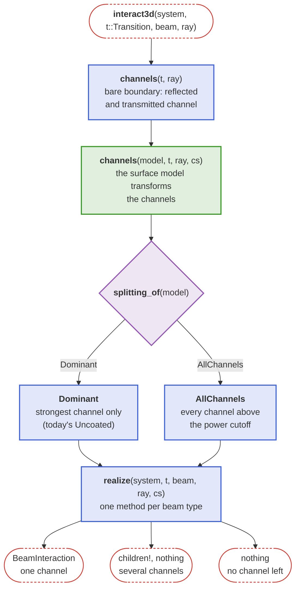

# Design: surface channels (roadmap #167, step 5)

> Design note for review. It is removed before the PR is merged; what survives goes into the
> docstrings and into "Transitions" in `docs/src/api/core.md`.

## Problem

Today a surface model builds the final result itself: `Uncoated` returns a `BeamInteraction`,
`BeamsplitterCoating` creates two child beams with `children!`, `JonesFilm` filters the field and
calls `cross_boundary`. Three consequences:

1. **Models do not compose.** A retarder film on a reflective polarizer, an aperture on a coating, or
   a coating on a grating cannot be stacked, because each model ends the interaction.
2. **Splitting is implemented per model and per beam type.** `BeamsplitterCoating` has its own
   helpers for `Beam`, `GaussianBeamlet` and `AstigmaticGaussianBeamlet`; a second splitting model
   (thin film, polarizing beamsplitter) would copy them (I2).
3. **There is no generic power cutoff**, and no place to decide whether a weak reflection (a ghost)
   is traced.

## Idea

A surface model does not build rays. It describes the **channels** of a boundary: the outgoing
directions and how each one transforms the field. The solver turns the channels into rays, once
per beam type.



## Types and verbs

```julia
"""A channel of a boundary: an outgoing direction and the transfer of the field into it."""
struct Channel{T, S <: AbstractSide}
    side::S               # Reflected() or Transmitted(): medium, enclosure and hint follow from it
    dir::Point3{T}        # outgoing direction
    P::SMatrix{3, 3, Complex{T}, 9}   # global field transfer, E_out = P * E_in
    a::Complex{T}         # scalar amplitude for beams without polarization (decision 1)
end

abstract type AbstractSide end
struct Reflected <: AbstractSide end      # back into medium_in(t)
struct Transmitted <: AbstractSide end    # into medium_out(t)
```

- `channels(t::Transition, ray)` returns the channels of the bare boundary as a tuple:
  Fresnel reflection and refraction, or only the reflection beyond the critical angle. This is
  today's `cross_boundary` split into "which directions" and "which field".
- `channels(model::AbstractSurfaceModel, t, ray, cs)` transforms the tuple `cs`. This is the one
  hook a model author implements. Default: `cs` unchanged (`Uncoated`).
- `splitting_of(model)` is a trait (D3): `Dominant()` traces the strongest channel only,
  `AllChannels()` every channel whose power fraction exceeds `get_power_cutoff()` (a `Config`
  tolerance, S1). `Uncoated` is `Dominant()`, so results stay as they are (patch release).
- `realize(system, t, beam, at, cs)` builds the result, one method per beam type: one channel
  becomes a `BeamInteraction` with the hint of its side, several become child beams via
  `children!`, none ends the beam. Beamlets compute their channels per component ray and take the
  field transfer from the chief ray.
- The existing entry `interact3d(system, model, t, beam, at)` stays: its default is
  `realize(system, t, beam, at, select(model, channels(model, t, ray, channels(t, ray))))`. A
  model with its own `interact3d` method keeps working, so nothing breaks.

The models of #178 become:

| Model | `channels(model, t, ray, cs)` | `splitting_of` |
|---|---|---|
| `Uncoated` | `cs` | `Dominant()` |
| `BeamsplitterCoating` | reflected `P` → `r·P`, transmitted `P` → `t·P`, π on the reflected channel when entering; under TIR `cs` unchanged | `AllChannels()` |
| `JonesFilm` | transmitted `P` → `J·P`, drops a channel at or below `cutoff` | `Dominant()` |

What disappears: the `_beamsplitter_*_beam` helpers (6 methods), `transmit!`/`reflect!`,
`transmit_field!`, the beamlet method of `BeamsplitterCoating`, and the `E` argument of
`cross_boundary`.

## Stacks (step 8) on the same contract

A stack is itself a model, and its `channels` is a fold over its items:

```julia
struct SurfaceStack{I <: Tuple} <: AbstractSurfaceModel
    items::I
end
channels(s::SurfaceStack, t, ray, cs) = foldl((cs, item) -> channels(item, t, ray, cs), s.items; init = cs)
splitting_of(s::SurfaceStack) = ...   # AllChannels() if any item splits
```

**The order of thin layers is physical, not a stage order.** A retarder film laminated under a
reflective polarizer acts differently from the reverse; a ray coming from the other side meets the
layers in reverse order; a channel reflected by an outer layer passes the inner layers a second
time. So the items of a stack are listed from the substrate outward, and the fold is a **cascade**:
each layer maps every channel into its reflected and transmitted channels, and a reflected channel
is folded back through the layers it already passed. Multiple reflections between two layers
(Fabry-Perot) are not part of the cascade; they belong in a thin-film item (transfer matrix),
which handles a whole layer stack coherently.

Items whose place is fixed by physics (an aperture filters before anything else, scatter adds
channels at the end) may still declare their stage with a trait, so the user only lists them.

## Limits to document

- A channel transfers the field of a ray; the coherent sum of multiple internal reflections is the
  job of a thin-film model, not of the channel cascade.
- Scalar beams (`Ray`, `GaussianBeamlet`) carry no polarization: they use the scalar factor `a` of
  the channel (decision 1).
- Splitting a `GaussianBeamlet` multiplies the beamlets; the power cutoff bounds the tree.

## Decisions

1. **Scalar beams carry their own factor.** A `Channel` holds a complex scalar `a` next to `P`.
   Every model sets both: `BeamsplitterCoating` `a = r` or `t`, with π on the reflected channel
   when entering; `Uncoated` `a = 1` (scalar beamlets have no Fresnel loss today); Jones items leave
   `a` unchanged (scalar rays pass a polarizer unfiltered today). Deriving `a` from `P` was rejected:
   the phase of `tr(P)` depends on the local basis at a reflection.
2. **Ghosts come as a model.** `Uncoated` stays `Dominant()`. Fresnel ghosts will be a model with
   `AllChannels()` (e.g. `FresnelGhosts()`), set per face or as the default model of a system
   (`surface_model(system)`, default `Uncoated()`), in step 6/7. No keyword of `solve_system!`.
3. **The power cutoff is absolute:** relative to the power of the root beam, `|E|² / |E_root|²`,
   from `Config` (`get_power_cutoff()`), default 0, i.e. no cutoff and no change of results. Beams
   without an amplitude (`Ray`) are bounded by `depth_max` only.
4. **Names as drafted:** `Channel`, `channels`, `Reflected`, `Transmitted`, `splitting_of`,
   `Dominant`, `AllChannels` (public for model authors); `realize` stays internal.

## Plan of the PR

1. `Channel`, sides, `channels(t, ray)`; `realize` for `Beam` of `Ray` and `PolarizedRay`;
   `Uncoated` through the channels. All tests unchanged.
2. `BeamsplitterCoating` and `JonesFilm` on channels; the helpers removed.
3. `realize` for both beamlet types, full s/p splitting of the astigmatic beamlet.
4. Power cutoff; reflection phase convention in `conventions.md` (decision 3 of the checkpoint).
5. Docs: Transitions diagram, model author guide; agent skill if a public name changes.
