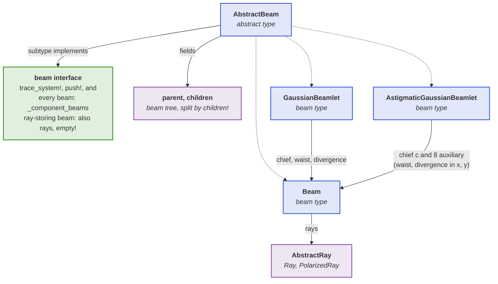
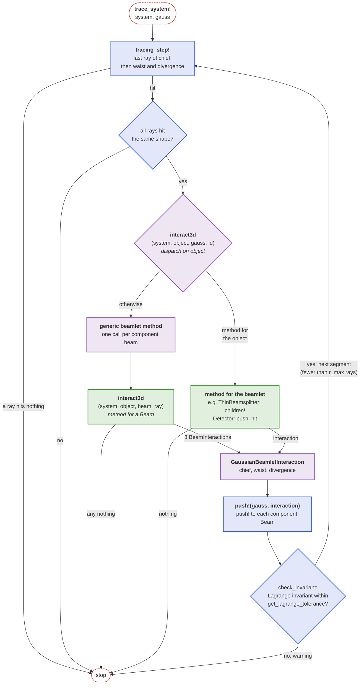
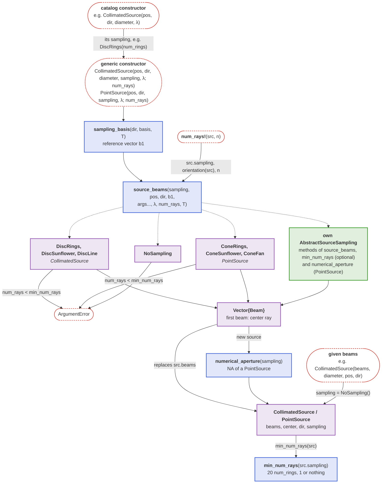
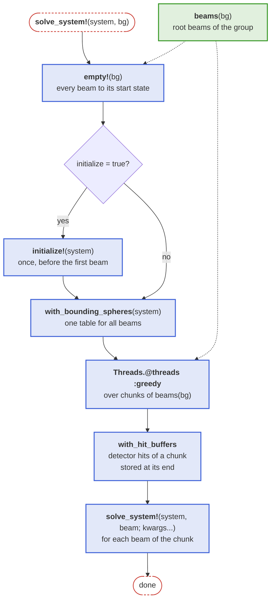

# Beams and sources

This page explains how the beams and sources described in the [Beams](@ref) section, including the beam groups, work internally, and what a developer has to provide so that a new beam type, beam group or source sampling works with the solver.

## Beam interface

A [`Beam`](@ref) stores a vector of rays, and the beamlets are built from it: a [`GaussianBeamlet`](@ref) traces a chief, a waist and a divergence `Beam` side by side, an [`AstigmaticGaussianBeamlet`](@ref) a chief `Beam` of [`PolarizedRay`](@ref)s and eight auxiliary ones. The diagram shows the beam types, the beams and rays they are made of, and the interface a new beam type implements (green):

## Tracing a beamlet

Components define [`BeamletOptics.interact3d`](@ref) for a `Beam` and one of its rays; a beamlet hands this call on to each of its component beams, unless the component defines a method for the beamlet itself. The diagram shows the tracing loop of a `GaussianBeamlet` and where the methods of a component author (green) are called; an `AstigmaticGaussianBeamlet` runs the same loop with its nine beams and also checks its complex invariant:

## Source sampling

A [`CollimatedSource`](@ref) or [`PointSource`](@ref) stores how its rays were sampled as a [`BeamletOptics.AbstractSourceSampling`](@ref), such that [`num_rays!`](@ref) can regenerate them with another number of rays in the current pose of the source. The diagram shows how the constructors and `num_rays!` generate the beams with [`BeamletOptics.source_beams`](@ref): dotted arrows are its dispatch branches on the sampling type, the green box is what an own sampling type implements.

An own sampling is a subtype of [`BeamletOptics.AbstractSourceSampling`](@ref) with a method of `source_beams`; the generic constructors and [`num_rays!`](@ref) then work for it without further code. A sampling for a `PointSource` also implements `numerical_aperture(s)`. A sampling with a lower bound on the number of rays implements `min_num_rays(s)`, and its `source_beams` throws an `ArgumentError` for a `num_rays` below it, as the samplings of BMO do.

## Solving a beam group internally

The diagram shows the steps of `solve_system!(system, bg)`, see [Solving a beam group](@ref); the green box is the getter of the beams that a new [`BeamletOptics.AbstractBeamGroup`](@ref) subtype provides, as a `beams` field or a method.

