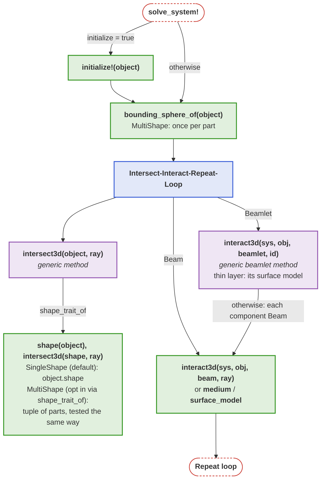
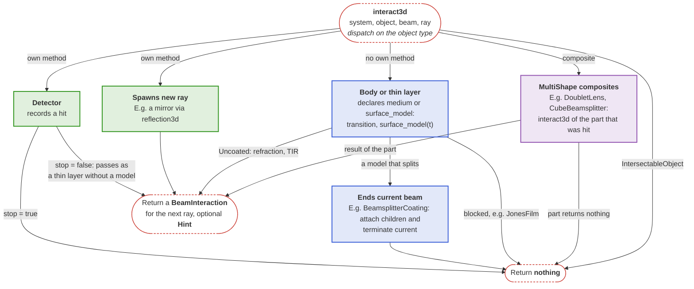

# Implementing components

This page explains which functions a solve calls on an optical component and what a developer implements for a new [`BeamletOptics.AbstractObject`](@ref) subtype. The geometry of a component lives in its shape, its optical effect at a boundary in its [`BeamletOptics.medium`](@ref) (a body) or [`BeamletOptics.surface_model`](@ref) (a thin layer), or in its own [`BeamletOptics.interact3d`](@ref) method; the solver connects both in the [Intersect-Interact-Repeat-Loop](@ref). For the components themselves, see [Optical components](@ref).

## Hooks called during a solve

The following diagram shows which functions a solve calls on an object. A new `AbstractObject` subtype implements `interact3d`, unless it is a body or a thin layer, which declares its `medium` or `surface_model` instead (see [Transitions](@ref)), and `initialize!`, `bounding_sphere_of` and `shape` only where the defaults or the existing shapes do not fit; it may also override the generic methods. `initialize!` runs only if the solve is called with `initialize = true`, for a beam group once before the first beam. How the loop chooses the next hit, including a `Hint`, is described in the [Intersect-Interact-Repeat-Loop](@ref):

## Interaction of the component families

The `interact3d` methods of the component families decide what follows a hit: a new ray, child beams, a recorded hit, a hand-over to the part of a composite that was hit, or the end of the beam. A body or a thin layer needs no own method: the fallback crosses the boundary through its [`BeamletOptics.surface_model`](@ref). The solver calls the method for a beam with the hit `ray`; for a beamlet, the generic method calls it for each component beam. The families are grouped by their result:

A composite calls the `interact3d` method of the part that was hit directly and does not run the solver again; it returns the result of that part. Parts that touch need no `Hint`: the solver finds the media on both sides of a shared face, see [Coincident hits](@ref) and [Transitions](@ref).
