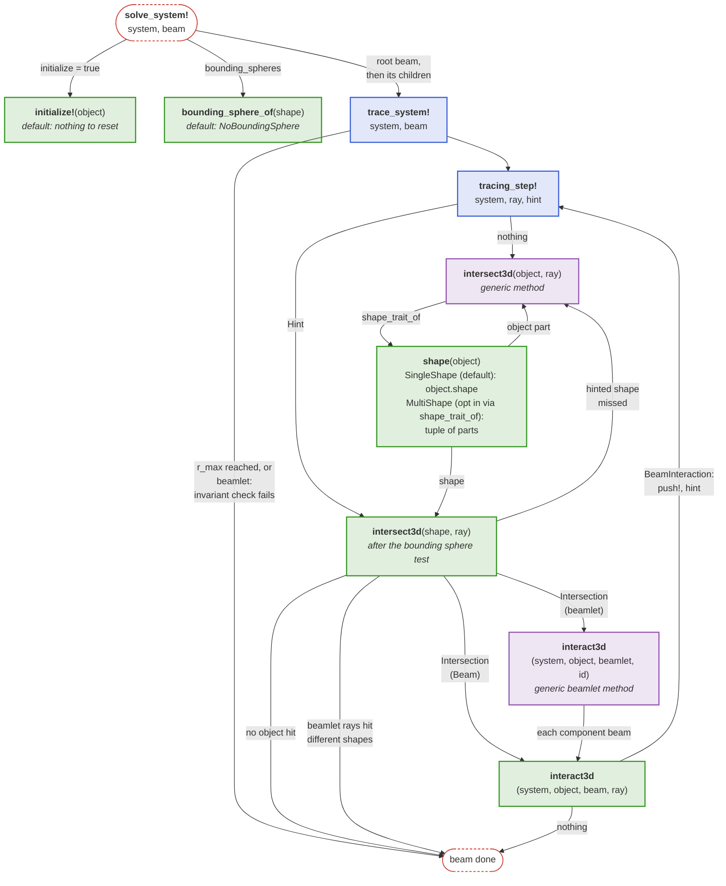
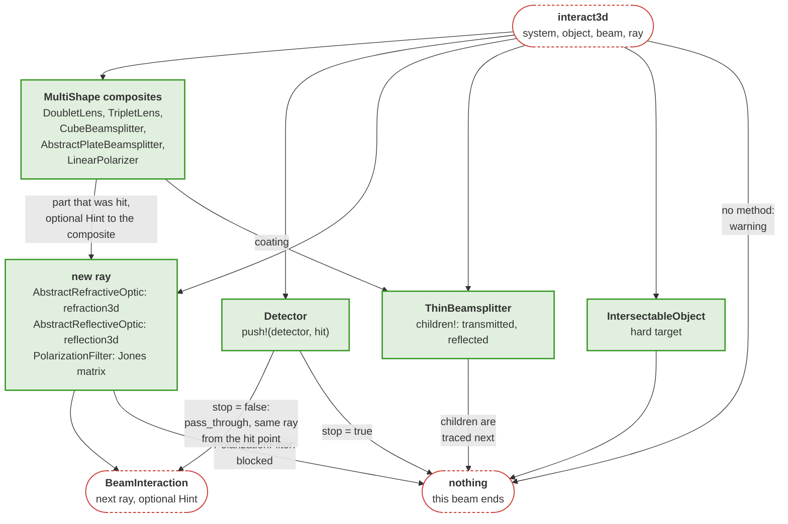

# Implementing components

This page explains which functions a solve calls on an optical component and what a developer implements for a new [`BeamletOptics.AbstractObject`](@ref) subtype. The geometry of a component lives in its shape, its optical effect in its [`BeamletOptics.interact3d`](@ref) method; the solver connects both in the [Intersect-Interact-Repeat-Loop](@ref). For the components themselves, see [Optical components](@ref).

## Hooks called during a solve

The following diagram shows which functions a solve calls on an object: a new `AbstractObject` subtype implements the green ones, `interact3d` always and the others only where the defaults or the existing shapes do not fit, and may override the generic methods in purple:

## Interaction of the component families

The `interact3d` methods of the component families decide what follows a hit: a new ray, child beams, a recorded hit, a hand-over to the part of a composite that was hit, or the end of the beam:

