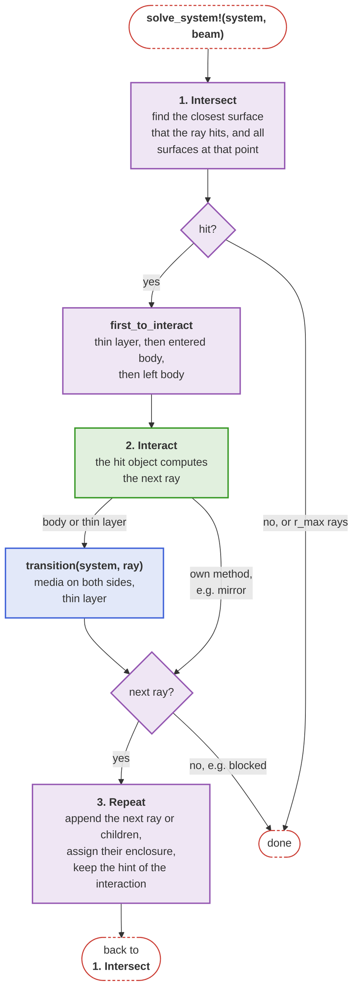
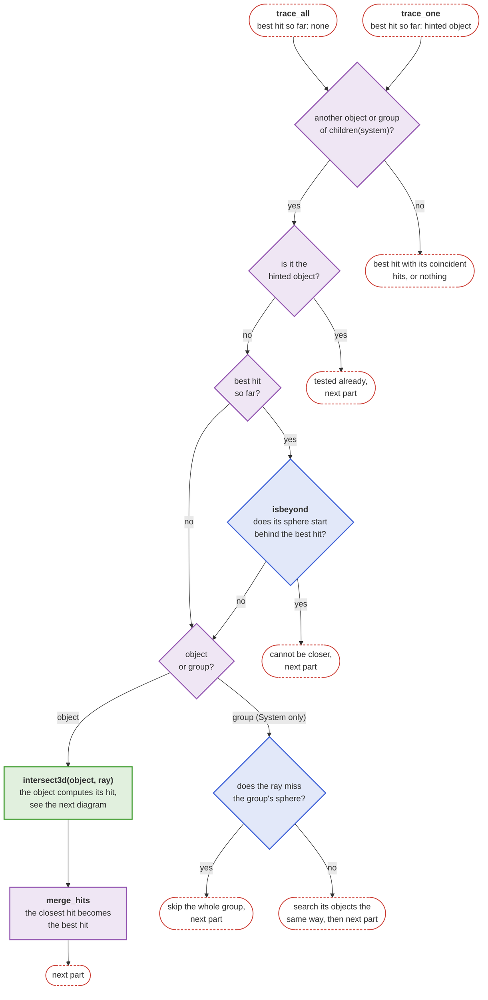
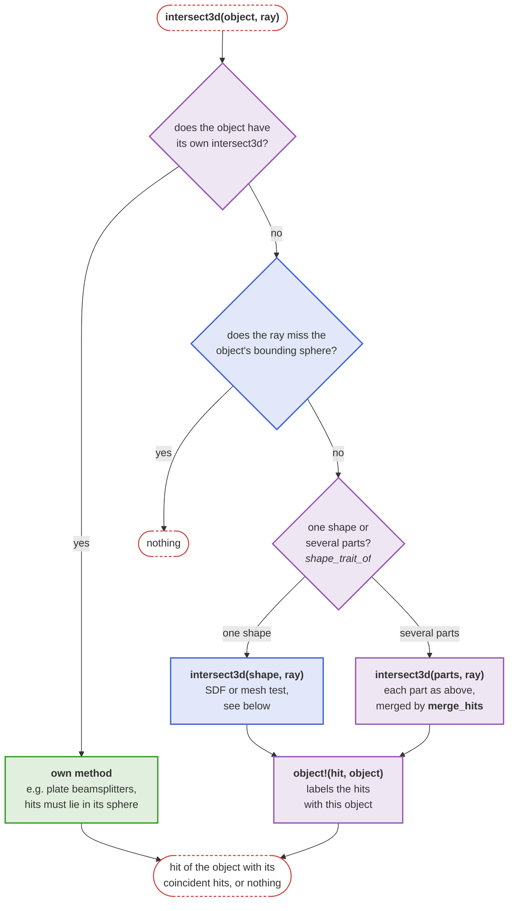
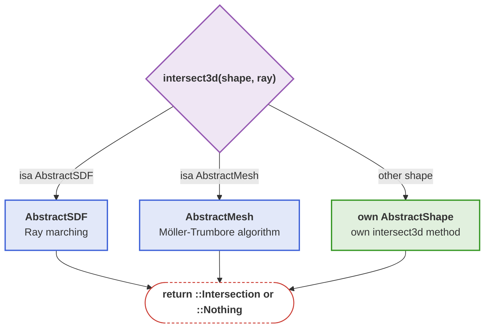
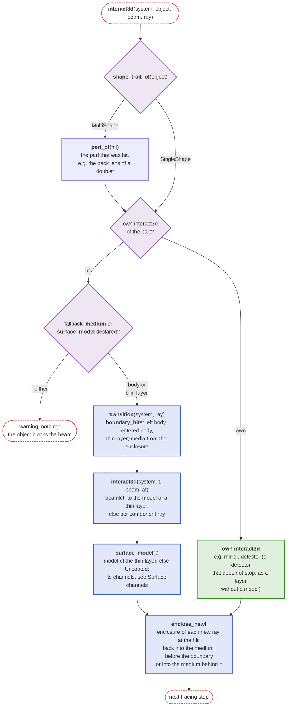
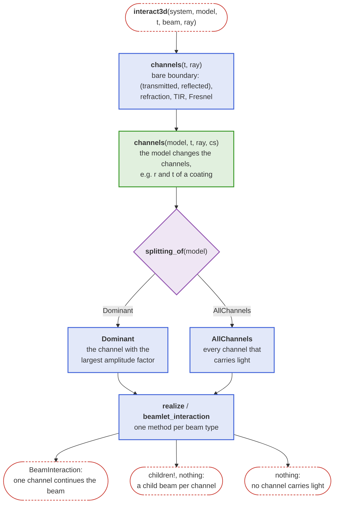
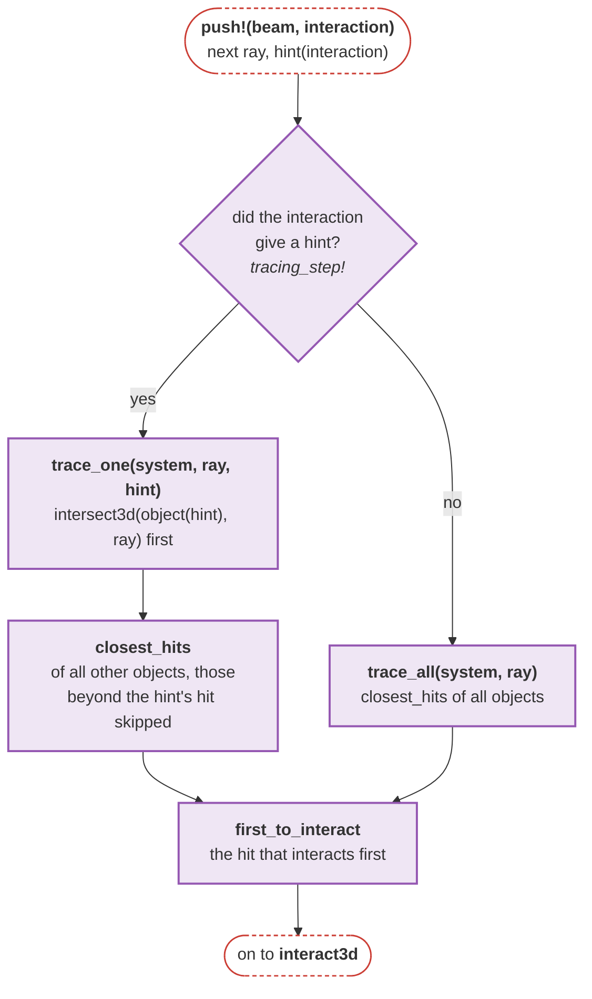
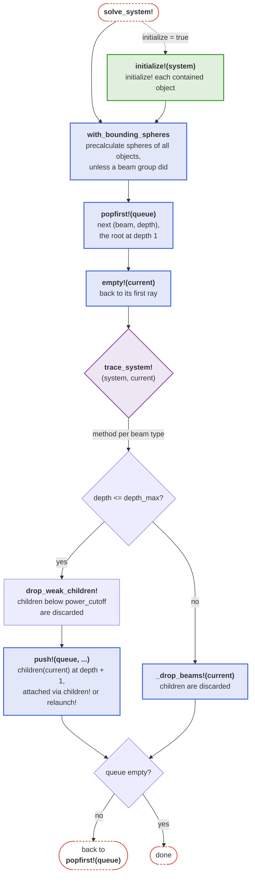
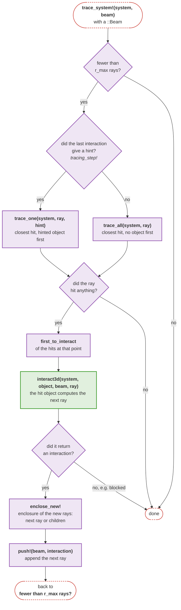

# Core design

The BMO package is intended to provide optical simulation capabilites with as much "out-of-the-box" comfort as possible, meaning that users should not have to worry about e.g. providing the correct optical sequence and exact alignment of objects. The following five design principles are core assumptions of the underlying API:

1. Optical interactions are decoupled from the underlying geometry representation
2. Optical elements are closed volumes or must mimic as such (exceptions apply, e.g. coatings)
3. Elements should be easily moveable and have working interactions for most angles of incidence
4. Without additional knowledge, tracing is performed non-sequentially
5. With additional knowledge, tracing is performed sequentially

## Intersect-Interact-Repeat-Loop

The first two principles will be elaborated upon in more detail in the [Geometry representation](@ref) section. For the latter two design decisions, the following high-level solver schematic can be used to abstract the steps that are performed when calling [`solve_system!`](@ref) with an input system and beam:



This scheme is loosely referred to as the **Intersect-Interact-Repeat-Loop** and consists of the following steps:

1. Calculate the closest **Intersection** between a ray/beam and the objects within the system. All surfaces at the closest point are kept as [Coincident hits](@ref), e.g. the faces of a cemented doublet, and the one that interacts comes first.
2. Calculate the optical **Interaction**: `interact3d` is dispatched on the object that was hit. An object with its own method computes the interaction itself, e.g. a mirror or a detector. The default methods of refracting bodies and thin layers read the [Transitions](@ref) at the hit, the media on both sides, and hand the ray to the surface model of the boundary or to the thin layer.
3. Attach the next part of the ray chain or beam tree. The solver assigns the bodies that enclose the new rays.
4. Use the new information to repeat 1.

Once this procedure has been completed, the alignment of the system or other time-dependent optical properties (e.g. the phase of a Gaussian beamlet) can be updated. A new call of [`solve_system!`](@ref) solves the beam again from its start. This is described in more detail in the section: [Tracing systems](@ref).

The next sections will focus on the **Intersection** and **Interaction** steps.

## Intersections

Calculating intersections between straight lines, i.e. rays, and surfaces is a central challenge for every geometrical optics simulator. This must be done with high numerical precision, since many optical effects are sensitive on the order of the wavelength of the light under consideration with respect to position and direction [Hecht:2018; p. 265 ff](@cite). In order to define this mathematically or algorithmically, many different methods exist [Hanrahan:1989](@cite). The first question is, how is the geometry of the problem defined. This topic is treated in the [Geometry representation](@ref) section. The second question concerns then the algorithm or equation that allows to calculate the point of intersection between a ray and the surface of the element. This function is called `intersect3d` and is, at its core, defined for each `shape` and `ray`:

```@docs; canonical=false
BeamletOptics.intersect3d(::BeamletOptics.AbstractShape, ::BeamletOptics.AbstractRay)
```

Regardless of the underlying concrete implementation, each call of `intersect3d` must return `nothing` or the following type:

```@docs; canonical=false
BeamletOptics.Intersection
```

Since an optical element can consist of multiple joint shapes, the return type must store which specific part of the object was hit: the `shape` of the `Intersection` is that part, and the solver compares and looks up the hit part by this reference, e.g. to decide whether the rays of a beamlet hit the same shape. The `object` of the `Intersection` is set by the solver, the `intersect3d` method of a shape leaves it `nothing`.

The closest hit of a ray is found on two levels: the solver searches the system for the objects that the ray can reach, and each object it reaches computes its own hit.

The search, shown below, goes through `children(system)`, the top-level objects and groups of the system, one at a time and keeps the closest hit found so far. Once there is a hit, every part whose bounding sphere the ray enters only beyond that hit (plus `get_coincidence_tolerance()`, so that touching surfaces are still found) is skipped, see [Bounding sphere pretest](@ref). A group is entered only if the ray reaches its sphere; its objects are then searched in the same way. `trace_all` starts without a hit. `trace_one` starts with the hit of the hinted object, so it can skip more parts from the start, see [Hints](@ref). A [`StaticSystem`](@ref) has no groups while tracing, since it flattens them when it is built.



Where surfaces touch, e.g. the faces of a cemented doublet, the ray hits several of them at the same point. `merge_hits` keeps the hits within `get_coincidence_tolerance()` of the closest one as a chain, see [Coincident hits](@ref).

Each object that the search reaches computes its hit with `intersect3d(object, ray)`, shown below. The default method tests the bounding sphere of the object first and then its shape or parts. A component can define its own method instead, as the plate beamsplitters do, e.g. the [`RectangularPlateBeamsplitter`](@ref). Once there is a hit, the search skips the object by this sphere, so the sphere must enclose every hit of such a method as well, see [Bounding sphere pretest](@ref).



The shape backend is selected by dispatch on the type of the shape, see [Geometry representation](@ref).



### Coincident hits

Touching elements, e.g. the two lenses of a cemented doublet or a coating on its substrate, share a surface. A ray that reaches it hits the surfaces of both within the accuracy of the intersection algorithms. Instead of picking one of them, the solver keeps all hits within `get_coincidence_tolerance()` (1 nm by default) of the closest hit as a chain, linked by the `next` field of the [`BeamletOptics.Intersection`](@ref):

```@docs; canonical=false
BeamletOptics.coincident_hits
BeamletOptics.merge_hits
```

Hence the hit of the ray does not depend on the order of the objects in the system or on a [`BeamletOptics.Hint`](@ref). Each hit holds its own object, shape and normal. One of them interacts with the ray: a surface that is no refracting body comes first, e.g. a coating, a mirror or a detector, then the surface of the body that the ray enters, then that of the body it leaves:

```@docs; canonical=false
BeamletOptics.first_to_interact
BeamletOptics.interaction_rank
```

The `object` of every hit is the object of the system (or of an object group) that was hit. For an object of several parts, e.g. a [`DoubletLens`](@ref), the part follows from the shape:

```@docs; canonical=false
BeamletOptics.part_of(::BeamletOptics.AbstractObject, ::Any)
```

### Bounding sphere pretest

Since the tracing is non-sequential, every ray is tested against every shape of the system, and most of these tests are misses. A shape can therefore provide a sphere that encloses it. A ray that does not pass through this sphere is a miss without a call of `intersect3d`. This is optional: a shape without a sphere is tested as described above.

```@docs; canonical=false
BeamletOptics.bounding_sphere_of(::BeamletOptics.AbstractShape)
```

All [Signed Distance Functions (SDFs)](@ref) and [Meshes](@ref) have a bounding sphere. An object of several shapes and an object group have the sphere around the spheres of their parts, such that a ray that misses it is tested against none of them. The table holds spheres of floating-point shapes only: for other number types, e.g. dual numbers under `ForwardDiff`, the pretest is skipped and the shapes are tested directly.

The spheres are not stored in the shapes or objects. [`solve_system!`](@ref) computes them once per call, for the poses that the objects have at that time, via `bounding_sphere_of(x)` into a table, which the intersection code reads per ray via `bounding_sphere_of(table, x)`. The solve of a beam group computes the table once for all its beams, and the solves of its beams keep it instead of computing it again. Outside of a solve there is no table, i.e. a direct call of `intersect3d(object, ray)` tests the object without a sphere.

The table lives in the task-local storage of the solving task, not in a `ScopedValue`, because the intersection code reads it for every object and ray and this read is several times cheaper. A task that is spawned within a solve does not see the table of its parent. It passes the table on by calling [`BeamletOptics.with_bounding_spheres`](@ref)`(f, table)`, as the solve of a beam group does. The system must not change while a solve runs, since the spheres are those of the poses at the start. The types in the sphere code are asserted, and the methods for the parts of an object are kept separate from those for a shape, because inference would otherwise widen their argument types and the shapes would be tested by code compiled for abstract types.

```@docs; canonical=false
BeamletOptics.bounding_sphere_of(::BeamletOptics.BoundingSphereTable, ::Any)
BeamletOptics.SingleBoundingSphere
BeamletOptics.MultiBoundingSphere
BeamletOptics.NoBoundingSphere
```

The spheres of a system can be shown via `render!(ax, BeamletOptics.bounding_sphere_of(x))` for one sphere or the `show_bounding_sphere` keyword of [`render!`](@ref).

## Interactions

Optical interactions are performed after the point of intersection has been determined. The `interact3d` interface allows users to implement algorithms that calculate or try to mimic optical effects. The fidelity of the algorithm is effectively only limited by the amount of information that can be passed into the `interact3d` interface. The method is defined as follows:

```@docs; canonical=false
BeamletOptics.interact3d(::BeamletOptics.AbstractSystem, ::BeamletOptics.AbstractObject, ::BeamletOptics.AbstractBeam, ::Union{BeamletOptics.AbstractRay, Int})
```

As with the `intersect3d` method, a predefined return type must be provided in order to make the [`solve_system!`](@ref) interface work. The `AbstractInteraction` is used in order to create "building blocks" from which the output beam is constructed.

```@docs; canonical=false
BeamletOptics.AbstractInteraction
```

An object whose `interact3d` method stores data in the object, e.g. a detector its hits, also implements [`initialize!`](@ref), which discards this data before a new solve.

### Transitions

At a boundary, the ray passes from one medium into another. The parts that the ray hits there play two roles: a part with a medium is a **body**, which the ray leaves or enters, e.g. a lens or a prism; a part without one is a **thin layer** between the media, e.g. a thin beamsplitter or a polarizing film. The [`BeamletOptics.transition`](@ref) at the hit of a ray holds both media and the layer. Hence a component needs no knowledge of the elements that touch it: the surface of a lens cemented to another lens refracts from one glass into the other, a beamsplitter coating on a substrate transmits into the substrate, and a film between two plates transmits from one plate into the other.

The physics at a boundary has one place: the [`BeamletOptics.surface_model`](@ref) of the transition. It is the model that the thin layer at the boundary carries, else an uncoated surface. Bodies and thin layers both hand their rays to it, so a coating acts the same whether it stands free or lies on a substrate. The diagram shows this and how the solver assigns the enclosure of the new rays.



```@docs; canonical=false
BeamletOptics.AbstractMedium
BeamletOptics.IsotropicMedium
BeamletOptics.medium
BeamletOptics.transition
BeamletOptics.Transition
```

Every ray carries the bodies that enclose it, which the transitions update. Hence the medium behind a boundary is the body around the one that the ray leaves, e.g. the water of a cuvette around a lens:

```@docs; canonical=false
BeamletOptics.Enclosure
```

A component creates its new rays without an enclosure. After each interaction, the solver assigns it to every new ray that starts at the hit, the continued ray and the first rays of child beams, by the side of the boundary into which the ray propagates: back into the medium before it, e.g. after a reflection, or into the medium behind it.

```@docs; canonical=false
BeamletOptics.enclose!
```

The physics at the boundary belongs to the boundary, not to one of the bodies. A body, e.g. any [`BeamletOptics.AbstractRefractiveOptic`](@ref), and a thin layer, e.g. a [`ThinBeamsplitter`](@ref), hand the ray to the [`BeamletOptics.surface_model`](@ref) of the transition:

```@docs; canonical=false
BeamletOptics.interact3d(::BeamletOptics.AbstractSystem, ::BeamletOptics.Transition, ::BeamletOptics.AbstractBeam, ::Union{BeamletOptics.AbstractRay, Int})
BeamletOptics.surface_model(::BeamletOptics.Transition)
BeamletOptics.surface_model(::BeamletOptics.AbstractObject)
BeamletOptics.AbstractSurfaceModel
```

#### Surface channels

A surface model does not build rays. It describes the **channels** of the boundary: the directions into which the ray leaves it, reflected back into the medium before it or transmitted into the medium behind it, and how each transfers the field. The solver builds the new rays from them, once for every beam type: the continued ray, child beams, or child beamlets whose component rays leave their own hits on the same side as the chief ray. A model implements only `channels`, and optionally `splitting_of`; it needs no code per beam type. The channels of the bare boundary come first, so a coating changes the Fresnel channels instead of computing refraction again (green: implemented by a model author, purple: dispatch).



```@docs; canonical=false
BeamletOptics.interact3d(::BeamletOptics.AbstractSystem, ::BeamletOptics.AbstractSurfaceModel, ::BeamletOptics.Transition, ::BeamletOptics.Beam, ::BeamletOptics.AbstractRay)
BeamletOptics.BoundaryChannel
BeamletOptics.AbstractSide
BeamletOptics.Transmitted
BeamletOptics.Reflected
BeamletOptics.channels
BeamletOptics.transfer
BeamletOptics.AbstractSplitting
BeamletOptics.splitting_of
BeamletOptics.Dominant
BeamletOptics.AllChannels
BeamletOptics.select_channels
BeamletOptics.realize
BeamletOptics.beamlet_interaction
BeamletOptics.power_fraction
```

The models of BMO:

```@docs; canonical=false
BeamletOptics.Uncoated
BeamletOptics.cross_boundary
BeamletOptics.BeamsplitterCoating
BeamletOptics.JonesFilm
```

A new refracting component declares its body via `medium`, a new thin layer its model via `surface_model(layer::MyLayer)`, like the [`ThinBeamsplitter`](@ref). Neither needs an `interact3d` method: without one, a body or a thin layer interacts at the boundary, and a beamlet at a thin layer is handed to its model, which may split it. An object that is neither, e.g. a mirror, implements `interact3d`. New physics at a boundary is a new `AbstractSurfaceModel` with a `channels` method, see [Surface channels](@ref).

The `interact3d` return type holds one new `beam` segment per interaction, which the solver appends to the current beam. Further beams, e.g. the reflected part at a beamsplitter, are attached to the beam as children by the component, and the solver queues them after the current beam, see [Tracing systems](@ref). After e.g. a lens surface air-to-glass interaction, the most likely next step is the refraction at the glass-to-air surface of the same lens. An interaction can tell the solver so with a `Hint`, which speeds up the next intersection.

### Re-emitting components

Some components do not continue a beam where it ended, but hand it to another solver and emit the result elsewhere, e.g. a fiber that takes the light at its input facet and releases it at its output facet. Their `interact3d` method samples the incoming beamlet segment as a field, lets the other solver compute the field at the exit and starts new beamlets there. The exchange format is the `PlaneField` of [OpticsBase.jl](https://github.com/StackEnjoyer/OpticsBase.jl) (see [OpticsBase interoperability](@ref)):

```julia
function BeamletOptics.interact3d(::AbstractSystem, fiber::MyFiber, agb::AstigmaticGaussianBeamlet, id::Int)
    f = PlaneField(agb, id; size, spacing, origin, axes)      # the segment that hit the fiber, on its input plane
    g = other_solver(f)                                       # PlaneField at the exit, with the full phase
    BeamletOptics.relaunch!(agb, [GaussianModeDecomposition(g)])
    return nothing
end
```

The new beamlets are attached with [`BeamletOptics.relaunch!`](@ref) instead of `children!`. Children added by `children!` continue the parent: its length, optical path and reference plane are counted on. A re-emitted beamlet already carries the full phase in its amplitude and starts at another place, so it must count its optical path from its own start.

```@docs; canonical=false
BeamletOptics.relaunch!
```

`PlaneField(beamlet, id; ...)` is for components without a detector, e.g. in the `interact3d` of a component that hands the incoming beamlet to another solver: the segment that just hit the component is `id`. It builds a single hit of the segment and passes it to `PlaneField(hits; ...)`, which also takes the hits of several segments.

```@docs
OpticsBase.PlaneField(::AstigmaticGaussianBeamlet, ::Integer)
OpticsBase.PlaneField(::AbstractVector{<:Union{BeamletOptics.GaussianBeamletHit, BeamletOptics.AstigmaticGaussianBeamletHit}})
```

## Hints

The [`BeamletOptics.Hint`](@ref) interface allows developers to tell the non-sequential solver which object will probably be hit during the next cycle of the [Intersect-Interact-Repeat-Loop](@ref). The solver tests this object first. Its hit lets the solver skip all objects whose bounding sphere lies beyond it, which saves most of the intersection tests in a large system.

```@docs; canonical=false
BeamletOptics.Hint
```

A `Hint` never changes the result of the trace: the hinted object is not preferred over a closer one, and an object that is moved away from its hinted neighbour, e.g. the back lens of a doublet, leaves an air gap that the trace sees. Touching elements need no `Hint`, see [Coincident hits](@ref) and [Transitions](@ref). The diagram shows how the next tracing step uses the hint of an interaction.



The solver picks the `interact3d` method by the *object* of the hint, not by its shape. For a [`BeamletOptics.MultiShape`](@ref) component the hint therefore names the composite as `object` and the part that is hit next as `shape`, e.g. `Hint(cbs, shape(cbs.coating))`; `Hint(object)` alone fails for such an object, since `shape(object)` is a tuple.

!!! tip
    Any component can use a `Hint`: a single lens hints itself when a ray enters it or is totally internally reflected, since the next intersection lies on the same lens.

## Tracing logic

### Tracing systems

In the initial state, it is assumed that the problem consists of `objects <: AbstractObject` (in a system) and a `beam <: AbstractBeam` with a defined starting position and direction. No additional information is provided, and the specific path of the beam is not known beforehand. Consequently, brute force tracing of the optical system is required, involving testing against each individual element to determine the trajectory of the beam.

A call of [`solve_system!`](@ref) traces the beam tree breadth-first: it traces one beam after another and queues the children that the components attach, up to the keyword `depth_max` of [`solve_system!`](@ref) branching levels. Children that carry less than the fraction `power_cutoff` of the power of the root beam are dropped before they are queued.



```@docs; canonical=false
BeamletOptics.trace_system!
```

For a [`Beam`](@ref), `trace_system!` runs the loop below until the beam has `r_max` rays, its last ray hits nothing or `interact3d` returns `nothing`; the methods for beamlets run one `tracing_step!` per component ray and one `interact3d` for the whole beamlet per step, and also stop if the rays hit different shapes or the optical invariant check fails.



This non-sequential mode is comparatively safe in determining the "true" beam path, but will scale suboptimally in time-complexity with the amount of optical elements.

!!! info "Object order"
    Unlike with classic, surface-based ray tracers, the order in which objects are listed in the [`System`](@ref) object vector/tuple is not considered for the purpose of tracing.

## CPU and GPU support

Parallelizing the execution of a [`solve_system!`](@ref) call on the CPU is straight-forward, since the solution is independent for each beam or ray and the solver can run on multiple threads: the beams of a beam group are solved in parallel, see below. Objects that are mutated during a solve, e.g. detectors like the [`Detector`](@ref), need special consideration when implementing them, since multiple threads might be able to access the underlying memory, leading to race conditions. Specifically, this means ensuring e.g. atomic write and read access. The [`Detector`](@ref) takes a lock for its hits and, within a beam group solve, collects them in a buffer per chunk of beams.

With respect to GPU acceleration, this is not the case. Currently, all available implementations of [`solve_system!`](@ref) are highly branching algorithms which can not be implemented in a parallelized way easily. This will most likely require a specific new subtype of the [`BeamletOptics.AbstractSystem`](@ref) with determinable sequential properties. This is not a development goal as of the writing of this section.

The beams of a group are solved in chunks, and all beams of a group share one table of bounding spheres. It belongs to a task, so each task of the threads sets it for its beams. Each chunk collects its detector hits and stores them at its end. A free task takes the next chunk, because the beams of a group differ in cost (e.g. the inner rings of a source pass a lens, the outer ones miss it), and those of similar cost lie next to each other. Four chunks per thread balance most of the load. Each further chunk costs a channel access and a flush, which shows if all beams cost the same.


