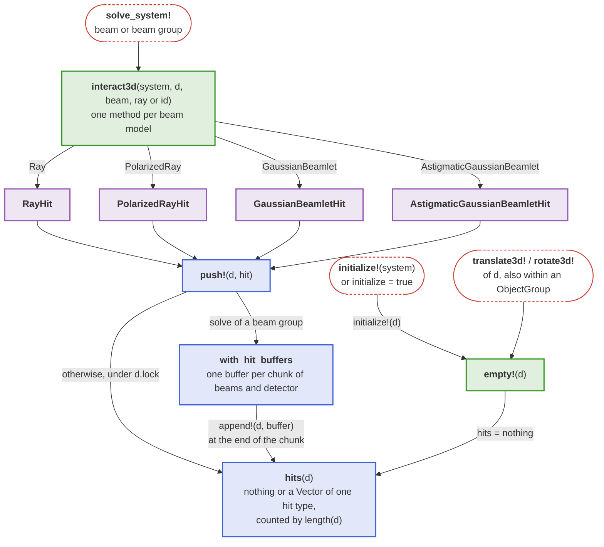
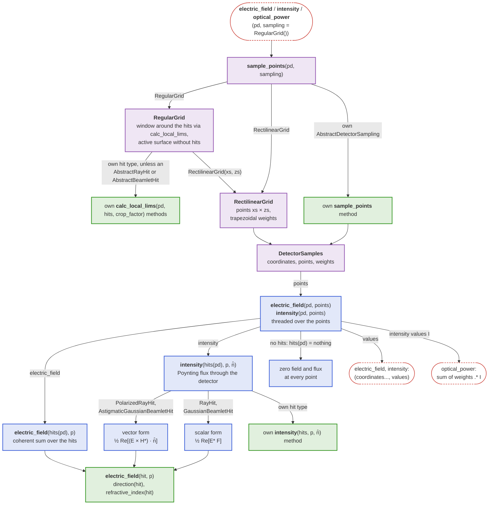
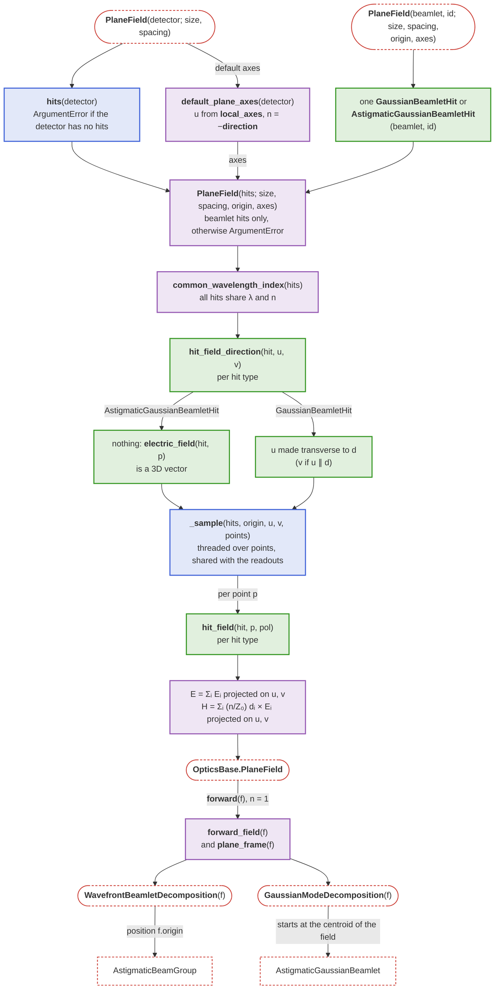

# Detector internals

This page explains how the [`Detector`](@ref) described in the basics is implemented internally, and what a developer has to provide so that a new hit type or sampling works with the readouts. What a readout computes is defined in [Reading out a detector](@ref) and [Field distributions](@ref).

## Hit recording

The following diagram shows how a solve records one hit type per beam model in a `Detector` and what empties it again; green boxes are the methods a new [`BeamletOptics.AbstractDetector`](@ref) implements.



## Readout pipeline

The following diagram shows how a readout turns a sampling into points and evaluates the stored hits there; green boxes are the methods a new sampling or hit type implements. A new hit type must also be added to the `hits` field of [`Detector`](@ref).



```@docs; canonical=false
BeamletOptics.AbstractDetectorSampling
BeamletOptics.sample_points
BeamletOptics.DetectorSamples
```

## OpticsBase extension internals

The diagram shows how the constructors share one sampling of the hits and how the return path leaves the `PlaneField` again. Blue boxes are BMO's detector internals that the extension reuses, green boxes depend on the hit type, purple boxes are the rest of the extension.


