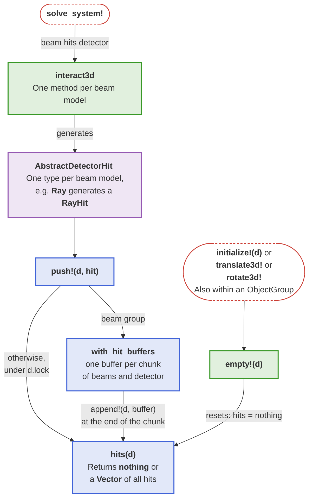
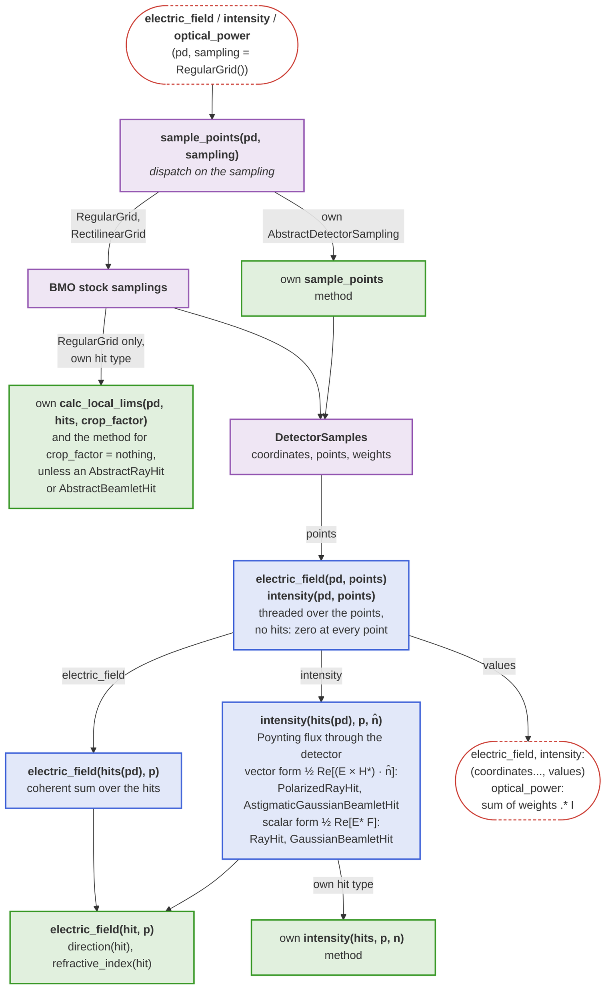
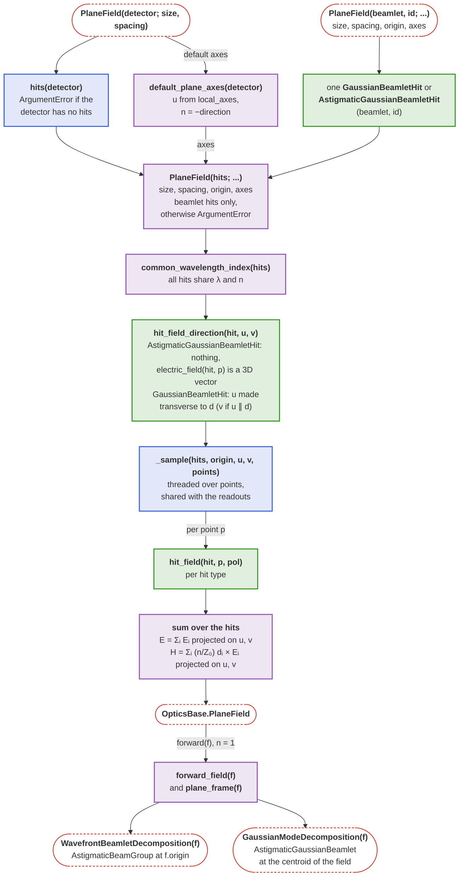

# Detector internals

This page explains how the [`Detector`](@ref) described in the basics is implemented internally, and what a developer has to provide so that a new hit type or sampling works with the readouts. What a readout computes is defined in [Reading out a detector](@ref) and [Field distributions](@ref).

## Hit recording

The following diagram shows how a solve records one hit type per beam model in a `Detector` and what empties it again. A new [`BeamletOptics.AbstractDetector`](@ref) implements `interact3d` and `empty!`.



## Readout pipeline

The following diagram shows how a readout turns a sampling into points and evaluates the stored hits there. A new sampling type implements `sample_points`; a new hit type implements `electric_field(hit, p)`, `direction(hit)`, `refractive_index(hit)` and an `intensity` method for a vector of its hits. Only the [`RegularGrid`](@ref) calls `calc_local_lims`, to find its window around the hits; a new hit type therefore implements it for a vector of its hits with a `crop_factor` and for `crop_factor = nothing`. A new hit type must also be added to the `hits` field of [`Detector`](@ref).



```@docs; canonical=false
BeamletOptics.AbstractDetectorSampling
BeamletOptics.sample_points
BeamletOptics.DetectorSamples
```

## OpticsBase extension internals

The diagram shows how the constructors share one sampling of the hits and how the return path leaves the `PlaneField` again.


