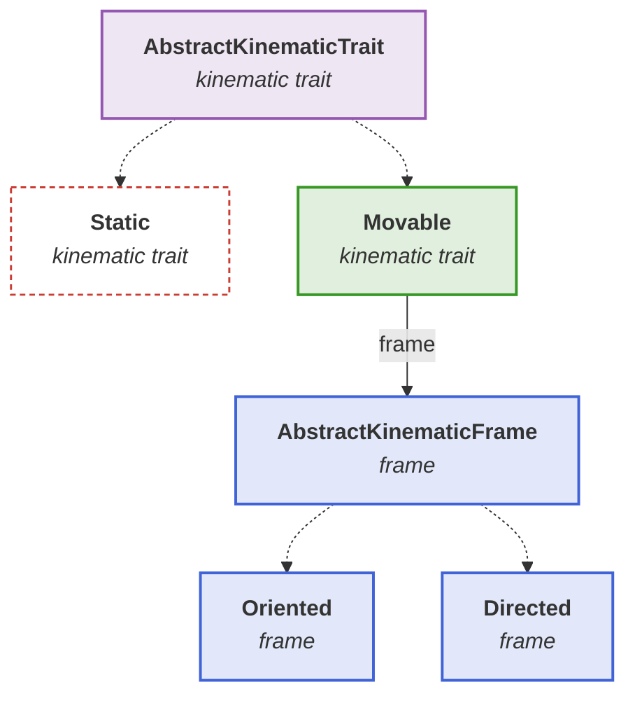
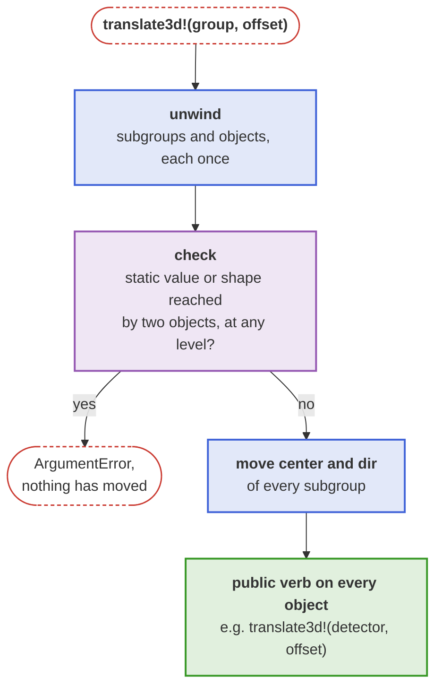

# Kinematic system

This page explains how the kinematic API described in the [Kinematics](@ref) section is implemented, and what a developer has to provide so that a new optical element, ray or beam type can be moved with it.

## Kinematic traits

Analogous to the [`BeamletOptics.AbstractShapeTrait`](@ref) of the [Geometry representation](@ref), the kinematic API is built on a trait that is dispatched on via multiple dispatch. Every public kinematic function, e.g. `translate3d!(x, offset)`, forwards to a trait-specific method `translate3d!(kinematic_trait_of(x), x, offset)`. As on the [Geometry representation](@ref) page, solid arrows are labeled with the field that leads from one type to the next, dotted arrows point to subtypes (purple: kinematic trait, green: implements the primitives `translate3d!` and `rotate3d!`, blue: frame, red: moving throws).



```@docs; canonical=false
BeamletOptics.AbstractKinematicTrait
BeamletOptics.kinematic_trait_of
```

## Static and movable entities

Whether an entity can be moved at all is defined by its trait. There is no fallback for [`BeamletOptics.kinematic_trait_of`](@ref): types that do not opt in throw an `ErrorException` when their trait is queried. A [`System`](@ref) is [`BeamletOptics.Static`](@ref). The abstract types [`BeamletOptics.AbstractObject`](@ref), [`BeamletOptics.AbstractRay`](@ref), [`BeamletOptics.AbstractBeam`](@ref) and [`BeamletOptics.AbstractBeamGroup`](@ref) declare themselves [`BeamletOptics.Movable`](@ref), so a new subtype of them only has to implement what the list below gives for its abstract type.

```@docs; canonical=false
BeamletOptics.Static
BeamletOptics.Movable
```

## Oriented and directed frames

The frame of a [`BeamletOptics.Movable`](@ref) entity selects whether the derived functions work on a full local coordinate system or only on a direction vector. Shapes, objects and beam groups are [`BeamletOptics.Oriented`](@ref), whereas rays and beams are [`BeamletOptics.Directed`](@ref).

```@docs; canonical=false
BeamletOptics.AbstractKinematicFrame
BeamletOptics.Oriented
BeamletOptics.Directed
```

## Type-specific implementation requirements

The primitives `translate3d!(::Movable, x, offset)` and `rotate3d!(::Movable, x, R)` are implemented differently for the individual abstract types. The requirements for subtypes are listed in the `Kinematic` section of the respective docstrings:

- [`BeamletOptics.AbstractObject`](@ref): the primitives forward to the [`BeamletOptics.AbstractShapeTrait`](@ref) of the object, see [`BeamletOptics.SingleShape`](@ref) and [`BeamletOptics.MultiShape`](@ref)
- [`BeamletOptics.AbstractRay`](@ref): only subtypes carrying direction-dependent data (e.g. the field vector of a [`PolarizedRay`](@ref)) need their own `rotate3d!`
- [`BeamletOptics.AbstractBeam`](@ref): a subtype needs no move methods, only `_component_beams` (a ray-storing beam returns itself and also implements `rays` and `empty!`); every move resets the beam via `empty!`, and moving a child beam throws an `ArgumentError`
- [`BeamletOptics.AbstractObjectGroup`](@ref): moves all members of `objects(group)` rigidly about the group `center`, see below
- [`BeamletOptics.AbstractBeamGroup`](@ref): moves its `beams` rigidly about the group `center`

## Shared parts

A part can be reachable along several paths, e.g. an object in two subgroups or a shape listed twice by a [`BeamletOptics.MultiShape`](@ref) object. Every container moves each of its parts once per motion, compared by identity (`===`). An object group first unwinds its tree, so that the primitives of an object type also apply within nested groups (blue: steps of the group, purple: check, green: the methods of the object type):



The shapes are collected recursively via `shape(object)`, down to the operands of composite SDFs. A group nested in another group moves as a frame via `position!`/`orientation!`; its own primitives are not called then.
