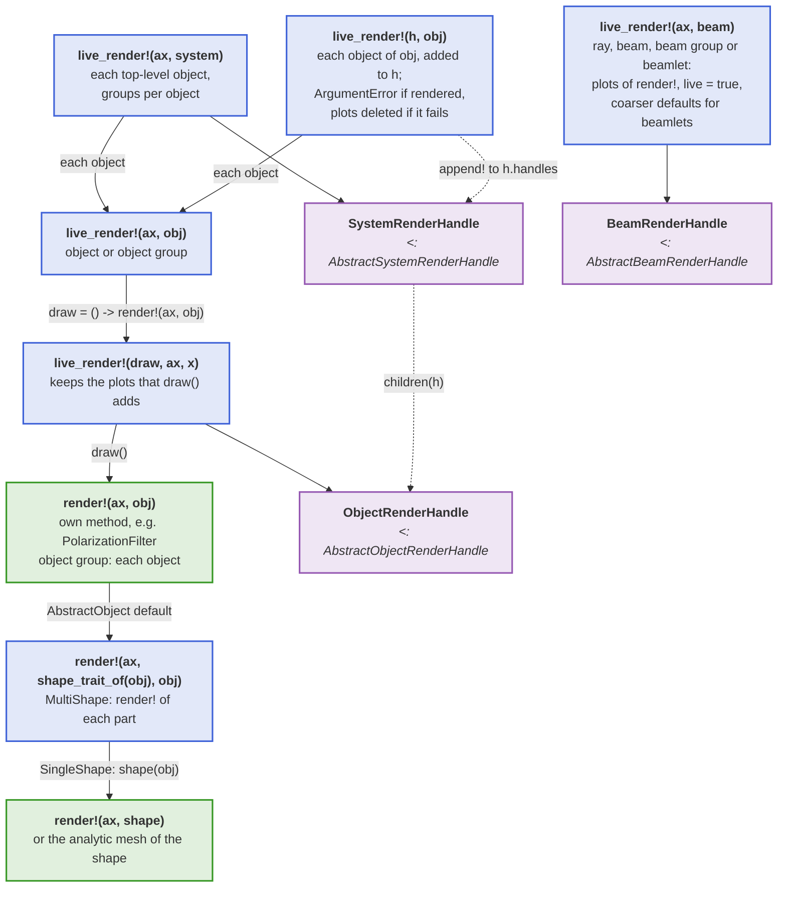
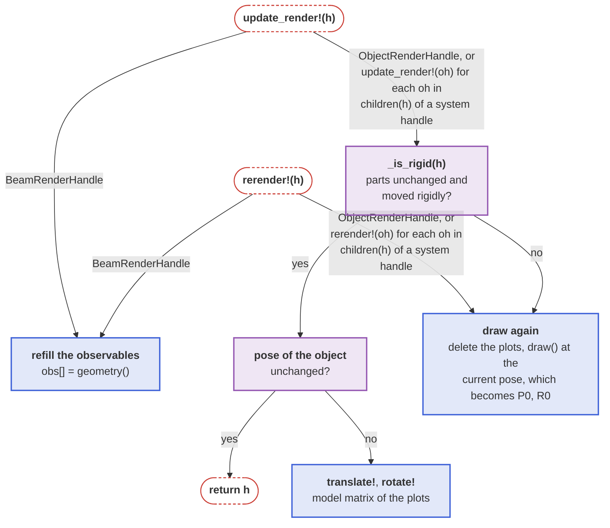
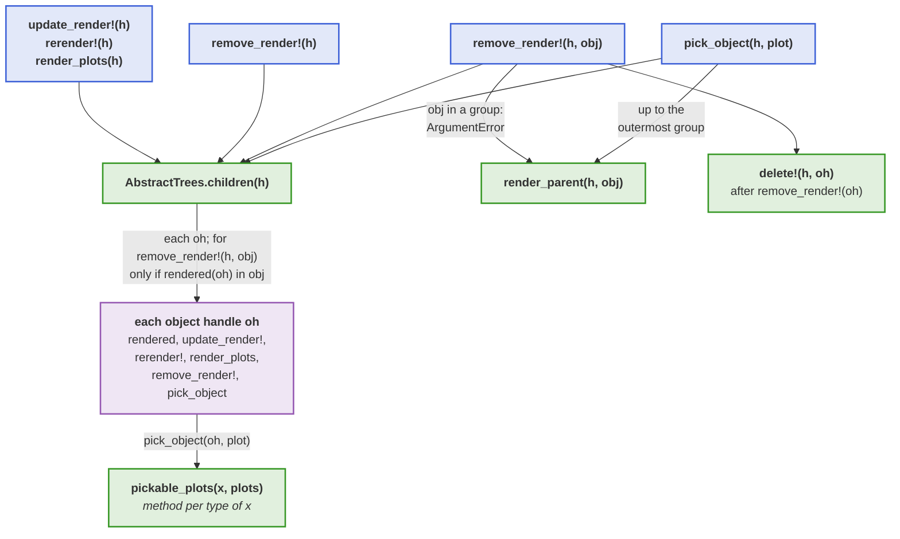

# Rendering internals

This page explains how [Live rendering](@ref) is implemented, and what a developer has to provide so that a new component, shape or handle type can be drawn and kept up to date. The user-facing functions are described in the Basics section.

## Live rendering dispatch

The diagram shows which `live_render!` method draws a thing and which handle it returns. BMO provides `render!(ax, obj)` and `render!(ax, shape)` as defaults, which a component or shape replaces with an own method to be drawn differently:



## Updating a handle

The diagram shows what `update_render!` and `rerender!` do for each handle type. `rerender!` skips
the checks and always draws an object again, e.g. after a change of its shape:



## Render handle protocol

Every handle returned by `live_render!` is a [`BeamletOptics.AbstractRenderHandle`](@ref). Packages
built on BeamletOptics, e.g. [BeamletOpticsGUI](https://github.com/StackEnjoyer/BeamletOpticsGUI.jl),
use the handles through a protocol instead of the concrete handle types of the Makie extension. There
are three abstract handle types: [`BeamletOptics.AbstractObjectRenderHandle`](@ref) for a component,
[`BeamletOptics.AbstractSystemRenderHandle`](@ref) for a system and
[`BeamletOptics.AbstractBeamRenderHandle`](@ref) for a ray, beam or beam group. They share the
accessors below.

```@docs; canonical=false
BeamletOptics.rendered
BeamletOptics.render_plots
```

A system handle groups the handles of its objects. It can be searched and changed at runtime:

```@docs; canonical=false
BeamletOptics.children(::BeamletOptics.AbstractSystemRenderHandle)
BeamletOptics.render_parent
Base.push!(::BeamletOptics.AbstractSystemRenderHandle, ::BeamletOptics.AbstractObjectRenderHandle)
Base.delete!(::BeamletOptics.AbstractSystemRenderHandle, ::BeamletOptics.AbstractObjectRenderHandle)
```

[`update_render!`](@ref), [`rerender!`](@ref), [`remove_render!`](@ref) and [`pick_object`](@ref) work on any
system handle through these accessors, so a handle type of your own only needs to implement them.

The diagram shows which accessors and hooks the methods of a system handle call, and where they pass on to the object handles:



[`pick_object`](@ref) uses `pickable_plots`; the colors of the material classes of the active look
are available via `look_colors`:

```@docs; canonical=false
BeamletOptics.pickable_plots
BeamletOptics.look_colors
```
