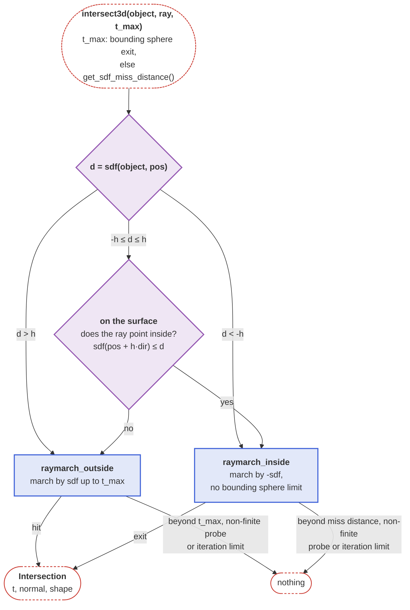

```@setup rays
dir = joinpath(@__DIR__, "..", "assets")

Main.DocUtils.conditional_include(joinpath(dir, "api_assets", "raymarching.jl"))
Main.DocUtils.conditional_include(joinpath(dir, "api_assets", "sdf_showcase.jl"))
```

# Signed Distance Functions (SDFs)

Signed distance functions in general represent geometry by providing a function that e.g. maps a point in R³ onto the closest scalar distance to the surface of the geometry [Osher:2003](@cite). This representation technique has already been used extensively for ray tracing applications in the field of computer graphics. For a quick introduction into SDFs the [website of Inigo Quilez](https://iquilezles.org/articles/distfunctions/) is referred to.

In the field of ray-based optical simulations, mathematical surface definitions, e.g. in the form of analytical equations for the surface sag or NURBs, are common [Sasian:2019; p. 44 ff](@cite). However, they are also costly to implement since no "one-size-fits-all" algorithm exists which could be implemented for the `intersect3d` function. This is why for this package, SDFs have been chosen to represent curved surfaces. This is due to the fact that for exact SDFs

1. the point of intersection can be calculated exactly with reasonable convergence criteria
2. the normal vector at the point of intersection can be calculated exactly using automatic differentiation
3. the ray marching algorithm works for any shape that provides a SDF
4. the ray marching procedure can be computed very efficiently

The viability of SDFs for radiation transfer simulations has already been demonstrated in the literature [McMillan:2022](@cite). **For optical ray tracing this is a new application to the best of our knowledge**. Representing lens shapes using the exact shape SDFs provided by Inigo Quilez is straight forward by combining cylinder and cut-sphere SDFs using boolean addition and subtraction. Further, custom iterative algorithms have been developed by O. Kliebisch in order to tie in (rotationally symmetrical) aspherical lenses into the ray marching formalism.

In order to implement new SDFs, the `AbstractSDF` interface should be used.

```@docs; canonical=false
BeamletOptics.AbstractSDF
```

The following shapes are currently implemented:

```@repl
using BeamletOptics # hide
BeamletOptics.list_subtypes(BeamletOptics.AbstractSDF);
```

## Ray marching algorithm

The algorithm works by iteratively propagating a ray from the point of origin through a scene. At each step, the SDF/s is/are evaluated at the current point along the ray. The scaral value tells the algorithm how far the current positions is from the nearest surface. This distance is guaranteed to be a safe step size: the ray can advance by that amount without “tunneling” through any geometry. The process repeats until one of two conditions is met: (1) the distance becomes smaller than a threshold (the ray has hit a surface), or (2) a maximum number of steps or maximum distance is exceeded (the ray escapes without hitting anything). The maximum distance is the point where the ray leaves the [bounding sphere](@ref "Bounding sphere pretest") of the shape. A visualization of this process is provided below. A ray propagates from the left to the right end of the scene. The step size is visualized as the radius of a sphere for each iteration.


Surface normals can be estimated numerically by sampling the SDF gradient around the hit point or by generating the automatic derivative of the SDF for exact descriptions. BMO uses both procedures, depending on the SDF type.

The following diagram shows how `intersect3d(object::AbstractSDF, ray, t_max)` picks `raymarch_outside` or `raymarch_inside` from the SDF value `d` at the start of the ray and the surface threshold `h = Config.get_sdf_surface_threshold()` (purple: decision, blue: marching).



On the surface, i.e. within `h` of it, the one-sided difference of the SDF along the ray decides whether the ray points inside, not the normal. Below the surface, the ray is inside for any direction. A ray inside is not limited by the bounding sphere, since its exit lies within any sphere around the shape.

### Marching from outside

- **Escaping the surface:** a ray that starts within the noise floor of the surface (`sdf < eps`) takes a minimum step that grows with the travelled path, `eps` plus 1 % of it. This escape prevents exhausting the iteration limit on inaccurate SDFs, while the blind step stays bounded to 1 % of the path, so it does not tunnel through thin parts. Once the ray is farther than `eps` from the surface, the minimum step is `eps`.
- **Misses:** a ray that escapes the scene makes the SDF track the true remaining distance, so the path length doubles with every step. Its overflow to `Inf` would take about 1000 steps, i.e. the whole iteration limit, whereas `get_sdf_miss_distance()` is passed after about 60 steps and the exit of a bounding sphere after a few. A non-finite probe, e.g. a `NaN` returned by `sdf`, would otherwise be misread as re-entering the surface; it is a miss.
- **Hit:** a probe within `eps` of the surface, inside or outside, ends the marching. The hit is refined from the last two probes by a few secant steps.
- **Normal:** the refined hit may lie slightly within the shape. There, the gradient of a composite SDF may stem from a part other than the one whose surface is hit, e.g. the face of a lens body that the vertex of a concave surface touches, and exactly on the surface such parts tie. The normal is therefore evaluated slightly outside: the point is moved back along the ray until it lies about as far outside as the hit lies inside, estimated from the slope of the SDF along the ray, and the back-off is clamped to the range `eps / 100` to `eps`.
- **False positives:** a hit whose normal points along the ray is numerical noise of a ray leaving an SDF. It is rejected and the marching continues from the probe.

### Marching from inside

- **Step:** the ray is marched by `-sdf`, which is not larger than the distance to the surface for an SDF that is exact or a lower bound inside, so no step passes the exit. A ray that starts on the surface counts as inside once it is deeper than `eps`; before that, no point of the starting surface is taken for an exit.
- **Minimum step:** a step of at least `eps` plus 0.1 % of the travelled path leaves the starting surface and the internal seams of composite SDFs, e.g. the face between two parts of a [`BeamletOptics.UnionSDF`](@ref), where the SDF is about 0 within the object. A step that thereby passes the exit ends outside and is caught there.
- **Over-relaxation:** each step is first stretched by a factor ω (**Keinert et al., 2014**). The stretched step is kept if it ends inside and the balls of radius `-sdf` around both of its ends cover it, i.e. no surface lies in between; otherwise the plain step is taken. ω starts at 1.6 and doubles with every kept step, up to 32, e.g. while the ray leaves the starting surface or a seam, and falls back to 1.6 after a plain step.
- **Exit:** a point where the SDF is about 0 is an exit only if the SDF is positive a short step `h` further along the ray, in contrast to an internal seam. The exit is then refined within the bracket that contains it, and its normal is evaluated just outside. The refinement is a regula falsi in the Illinois variant: when the same end of the bracket is kept twice in a row, its SDF value is halved for the next secant, while the final secant uses the unscaled values. A secant point outside the bracket, e.g. from a `NaN` of the SDF, is replaced by the midpoint, i.e. a bisection step.
- **Grazing rays:** a ray that leaves the shape before it gets deeper than `eps` grazes the surface. Its hit is the first probe beyond `h` outside, with the normal there.

### Smoothness for automatic differentiation

Hits move continuously with the ray and the shape, instead of jumping with the marching steps, so that finite differences and automatic differentiation of traced values work. This requires SDFs that are smooth where rays hit them, including on the optical axis. The radius `r` from the axis has no derivative there, so the sags of conic and aspheric surfaces are evaluated as functions of `r²`, and the spherical caps of lenses use the 3D distance from the center of the sphere instead of the 2D distance in the plane of revolution.

## Composite SDFs

In order to make use of the dispatch capability of Julia, boolean composite SDFs allow users to easily combine SDFs using the `+` and `-` operators. Both share a common field layout and pivot-aware kinematics, defined by the `AbstractCompositeSDF` interface:

```@docs; canonical=false
BeamletOptics.AbstractCompositeSDF
```

A composite does not transform points itself: its `sdf` and `normal3d` pass the world point on to the operands, which apply their own transformation, and the normal of an operand is returned as it is, in world coordinates, not multiplied by the orientation of the composite.


### Union

```@docs; canonical=false
BeamletOptics.UnionSDF
```

The normal of a union is the normal of its closest operand. Operands that are equally close up to rounding touch each other tangentially, e.g. the vertex of a concave lens surface touches the face of the lens body. Both give the same normal, but only the outer one, i.e. the boundary of the union next to the point, gives its change, e.g. the derivative of the normal with respect to the pose of the lens in automatic differentiation. The tie is therefore broken by probing the tied operands at four points beside the surface point, offset along the tangent plane and outward, so that the probes lie outside of the union; the operand closest there wins. See the warning above for the size of the offset.

### Difference

```@docs; canonical=false
BeamletOptics.DifferenceSDF
```

!!! info "Exactness"
    Boolean addition of non-overlapping, exact SDFs stays exact. Boolean subtraction, by
    contrast, only yields a *bound*: `max(-a, b)` under-estimates the true distance near
    the seam between operands. This under-estimate is the *safe* direction for sphere
    tracing — it never causes tunneling, only a few extra ray marching iterations near
    concave creases. At the seam, the automatic derivative of `max(-a, b)` can pick the
    wrong operand; the normal of a [`BeamletOptics.DifferenceSDF`](@ref) is
    therefore taken from the active operand by explicit selection, which keeps it exact. For
    information refer to the website of [I. Quilez](https://iquilezles.org/articles/distfunctions/)

The active operand of a difference at a point is the one that gives the maximum, i.e. the base or the tool `t` with the largest `-sdf(t)`. On a wall carved by a tool, the outward normal of the difference is the inward normal of that tool, hence the normal of the tool is negated.

## Conic and aspheric surfaces

The [`BeamletOptics.ConicSDF`](@ref) divides its distance to the front surface, the axial offset from the surface, by the gradient norm `sqrt(1 + Z'^2)` of the sag `Z`, taken at the rim radius of the aperture instead of at the local radius. The slope `Z'` grows monotonically with the radius for every conic family, so this rim value bounds the gradient norm over the whole segment (a global Lipschitz bound), and dividing by it can only make the distance more conservative than the locally linearized estimate. The locally linearized distance, in contrast, can overestimate the true distance to a curved surface away from the vertex, since it ignores the second-order correction from the curvature. The surface itself does not change: the front distance is exactly 0 on it for any scaling. Since the sag is also monotonic in the radius from the parent axis, the axial extent of an off-axis segment, e.g. for its bounding sphere, follows from the sags at the smallest and the largest parent radius of the aperture.

Aspheric surface SDFs compute a 2D distance in the plane of the radius and the optical axis and revolve it around the local y-axis. The 2D code follows the ISO 10110 and textbook convention with the sag along z, so the local coordinates are reinterpreted: x and z are transversal, y is the optical axis. The 2D shape is a closed perimeter, not an open surface: line segments close it, and a convex surface that curves back towards negative sag is closed at its maximum sag instead of at the sag of its edge. Outside of the aperture, the distance to these closing segments, which include the edge points of the surface, is the shortest distance. Acylindrical surface SDFs use the same 2D distance with the local z-coordinate as the transversal coordinate and y as the axis, and extrude it along the local x-axis instead of revolving it.

## Convex polygon prisms

The [`BeamletOptics.PolygonPrismSDF`](@ref) extrudes the exact 2D distance to a convex polygon along the local z-axis. Its constructor validates the polygon once:

- **Orientation and area:** the signed area of the polygon follows from the shoelace formula, taken relative to the first vertex. This makes the test invariant under translation, i.e. free of cancellation for polygons far from the origin. A polygon with zero area is rejected, and a clockwise polygon is reversed to counter-clockwise.
- **Convexity:** every corner must turn left by more than a small tolerance, and the edges must turn by 2π in total. The second condition rejects star polygons, whose corners all turn left but whose edges turn by a multiple of 2π.

The 2D distance takes the largest signed distance of the point to the lines of the edges, along their outward normals. Inside the polygon, and outside wherever the closest point lies within that edge, it is exact, and its gradient is smooth on the faces. Outside and beyond one of the ends of that edge, the closest point is the vertex at that end, and the distance is the one to the vertex.