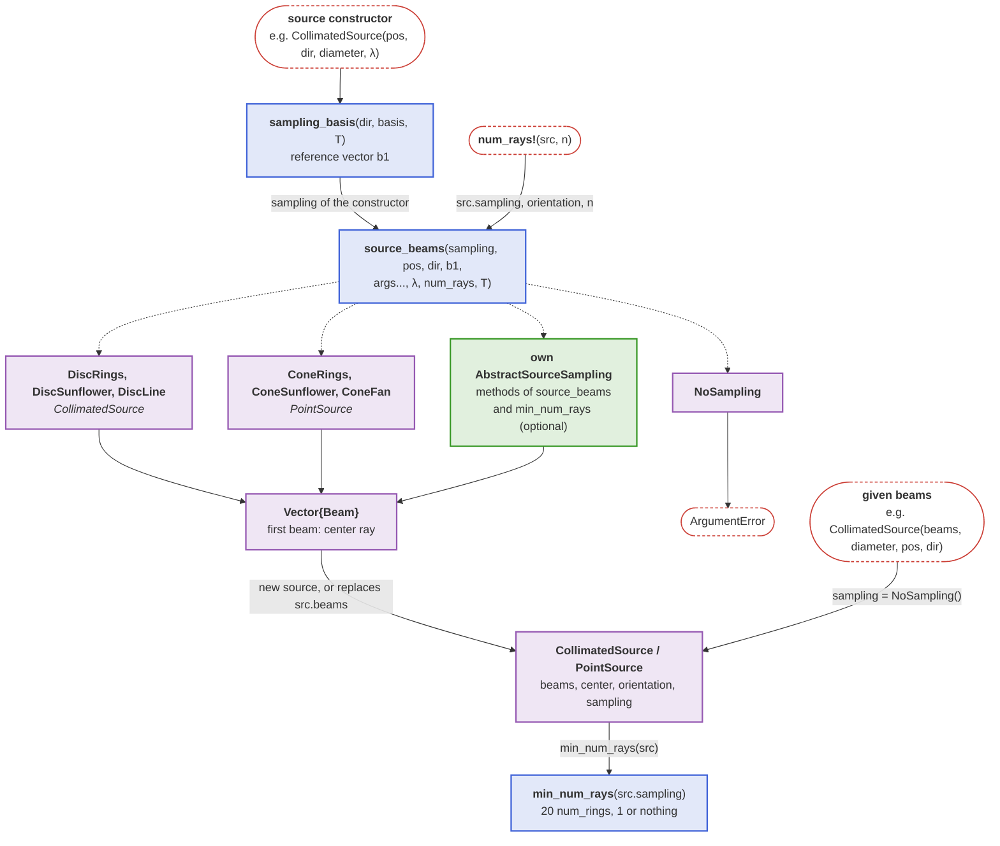
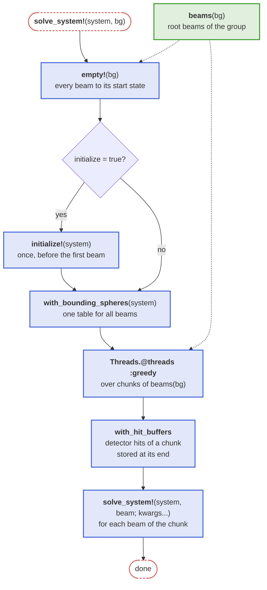

```@setup beam_groups
beam_showcase_dir = joinpath(@__DIR__, "..", "..", "assets", "beam_renders")

Main.DocUtils.conditional_include(joinpath(beam_showcase_dir, "collimated_sc.jl"))
Main.DocUtils.conditional_include(joinpath(beam_showcase_dir, "pointsource_sc.jl"))
```

# Beam groups

For convenience, the [`BeamletOptics.AbstractBeamGroup`](@ref) offers a container-like interface for groups of [`Beam`](@ref)s as commonly used in other software packages. The following concrete implementations are currently provided:

```@repl
using BeamletOptics # hide
BeamletOptics.list_subtypes(BeamletOptics.AbstractBeamGroup);
```

Refer to the following sections for convenience constructors to generate the sources listed above.

!!! tip "Moving a beam group"
    Every beam group has a source position (`center`) and an [`orientation`](@ref) matrix, whose second column is the central source [`direction`](@ref) and whose first column is the sampling reference vector (`basis`). Both are updated when the group is moved. Refer to [`BeamletOptics.AbstractBeamGroup`](@ref) for the convention and to [Moving sources](@ref) for the kinematic API.

!!! info "Center ray"
    The first beam of every [`CollimatedSource`](@ref) and [`PointSource`](@ref) generated by one of the constructors below is the center ray: it starts at the source position along the central source direction. This does not apply to sources that wrap given beams.

## Collimated beam source

The collimated beam source is ideal to model light coming from a focal plane at infinity. This is useful for simulating plane wavefronts. You can define a collimated monochromatic [`Beam`](@ref) source as follows:

```@docs; canonical=false
CollimatedSource(::AbstractArray{<:Real}, ::AbstractArray{<:Real}, ::Real, ::Real)
```


Already existing beams, e.g. [`Beam`](@ref)s of [`PolarizedRay`](@ref)s as in the [Vectorial focusing at high NA](@ref) example, can be wrapped into a group with `CollimatedSource(beams, diameter, pos, dir)`. `PointSource(beams, NA, pos, dir)` and `AstigmaticBeamGroup(beams, pos, dir)` work analogously; instead of `dir`, a full `orientation` matrix can be passed.

A special constructor called [`UniformDiscSource`](@ref) is available, which offers an equal-area
sampling (Fibonacci pattern) and is thus favorable in situations where the weighting of the
individual beams becomes important, e.g. for calculating a point spread function using the [`intensity`](@ref) function.

```@docs; canonical=false
UniformDiscSource
```


## Point beam source

The `PointSource` type is used to model emission from a spatially localized source that radiates [`Beam`](@ref)s in a range of directions. This is commonly used to simulate conical emission patterns, such as light emerging from a fiber tip or a light source for a lens objective with a known focal distance. You can specify the origin and a propagation direction, which are then used to construct the monochromatic `PointSource`.

```@docs; canonical=false
PointSource(::AbstractArray{<:Real}, ::AbstractArray{<:Real}, ::Real, ::Real)
```

Below you can find an exemplary illustration of a `PointSource`.


Analogous to [`UniformDiscSource`](@ref), a special constructor called [`UniformPointSource`](@ref)
is available, which samples the spherical cap around `dir` with an equal solid angle per ray
(Fibonacci/sunflower pattern), rather than in concentric rings. It returns a plain [`PointSource`](@ref).

```@docs; canonical=false
UniformPointSource
```

## Line and fan sources

For layout sketches, or to trace only one section of a system (e.g. the meridional plane), a two-dimensional source is often sufficient. The [`UniformLineSource`](@ref) is the two-dimensional counterpart of the collimated source: a plane sheet of parallel [`Beam`](@ref)s that start equidistantly on a line. It returns a plain [`CollimatedSource`](@ref).

```@docs; canonical=false
UniformLineSource
```


The [`UniformFanSource`](@ref) is the two-dimensional counterpart of the point source: a plane fan of [`Beam`](@ref)s from a single point with equidistant angles. It returns a plain [`PointSource`](@ref).

```@docs; canonical=false
UniformFanSource
```


Both sources include the marginal rays and should be used with an odd number of rays. The plane of the rays is spanned by `dir` and the `basis` keyword argument. The rays stay in this plane only if the system is symmetric with respect to it. Since the rays sample a line or a plane angle instead of an area or a solid angle, these sources are not suited for calculating a point spread function with the [`intensity`](@ref) function.

## Sampling and number of rays

A [`CollimatedSource`](@ref) or [`PointSource`](@ref) stores how its rays were sampled as a [`BeamletOptics.AbstractSourceSampling`](@ref), such that [`num_rays!`](@ref) can regenerate them with another number of rays in the current pose of the source. The diagram shows how the constructors and `num_rays!` generate the beams with [`BeamletOptics.source_beams`](@ref): dotted arrows are its dispatch branches on the sampling type, the green box is what an own sampling type implements.



## Astigmatic Beam Groups

For complex sources, the package provides the [`AstigmaticBeamGroup`](@ref) container. Several constructors are available for different scenarios:

- [`GaussianBeamletDecomposition`](@ref): Tiling a large Gaussian beam into many small stable beamlets.
- [`WavefrontBeamletDecomposition`](@ref): Importing an arbitrary complex scalar field (e.g. from a phase screen or camera data), or a vector field with an independent, spatially varying polarization (e.g. `OpticsBase`'s `PlaneField`, see [OpticsBase fields as beam groups](@ref)).
- [`CollimatedGaussianBeamletSource`](@ref): A square grid of parallel beamlets (ideal for aperture diffraction).
- [`SphericalGaussianBeamletSource`](@ref): A point-like source emitting a cone of beamlets (ideal for focused/divergent beams).
- [`EllipticalGaussianBeamletSource`](@ref): A point-like source emitting an elliptical cone of beamlets (ideal for sources with different fast/slow axis divergence).

A field that is close to one Gaussian mode and too small to be tiled into beamlets, e.g. the output of a single-mode fiber, is not turned into a group: [`GaussianModeDecomposition`](@ref) fits a single [`AstigmaticGaussianBeamlet`](@ref) to it.

### OpticsBase fields as beam groups

With `using OpticsBase`, a `PlaneField` handed over by another solver (e.g. the exit field of a fiber computed by a beam propagation method) becomes BMO beams again. [`WavefrontBeamletDecomposition`](@ref) tiles it into one beamlet per sample, which needs beamlets much larger than λ. [`GaussianModeDecomposition`](@ref) fits a single Gaussian beamlet instead, for small fields close to one Gaussian mode such as single-mode fiber output. Both take only the forward-travelling part of the field and require the plane to lie in vacuum or air. The detector side, `PlaneField(::Detector)`, is described under [OpticsBase interoperability](@ref).

```@docs
WavefrontBeamletDecomposition(::OpticsBase.PlaneField)
GaussianModeDecomposition(::OpticsBase.PlaneField)
```

## Solving a beam group

[`solve_system!`](@ref) traces a beam group by solving each of its beams, multithreaded, and the hits of all beams accumulate on the same [`Detector`](@ref)s. The diagram shows the steps of `solve_system!(system, bg)`; the green box is the getter of the beams that a new [`BeamletOptics.AbstractBeamGroup`](@ref) subtype provides, as a `beams` field or a method.


