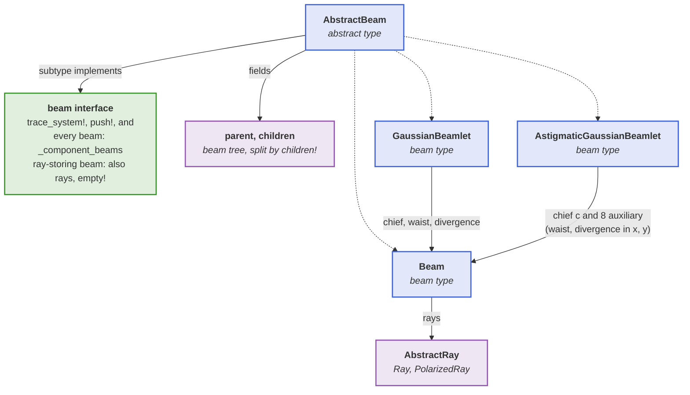
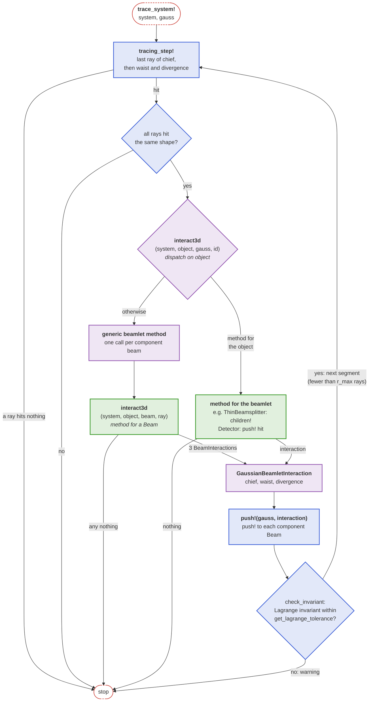

```@setup beam_catalog
beam_catalog_dir = joinpath(@__DIR__, "..", "..", "assets", "beam_renders")

Main.DocUtils.conditional_include(joinpath(beam_catalog_dir, "beam_catalog_showcase.jl"))
```

# Beams

As mentioned in the [Rays](@ref) section, a beam within the context of this package serves as a data structure for storing collections of rays, forming the backbone of the simulation framework. Beams are intended to be designed as [AbstractTrees](https://github.com/JuliaCollections/AbstractTrees.jl) to allow for ray bifurcations, e.g. in the case of optical elements such as beamsplitters. The [`solve_system!`](@ref) function relies on this data structure to perform ray tracing computations within optical systems. 

To ensure compatibility and extensibility, beam types must adhere to the [`BeamletOptics.AbstractBeam`](@ref) interface. Refer to its documentation for more information. Browse the catalog below, or refer to the table of contents for detailed documentation of the provided beam types and sources.

## Beam catalog

Beams, beamlets and beam groups are traced through a bi-convex lens onto a detector near its focus.

```@raw html
<ComponentCatalog catalog="beams" />
```

## Beam overview

```@contents
Pages = ["beams.md", "stigmatic_beam.md", "astigmatic_beam.md", "beam_groups.md"]
Depth = 2
```

## Beam models

A [`Beam`](@ref) stores a vector of rays, and the beamlets are built from it: a [`GaussianBeamlet`](@ref) traces a chief, a waist and a divergence `Beam` side by side, an [`AstigmaticGaussianBeamlet`](@ref) a chief `Beam` of [`PolarizedRay`](@ref)s and eight auxiliary ones. The diagram shows the beam types, the beams and rays they are made of, and the interface a new beam type implements (green):



### Interactions of beamlets

Components define [`BeamletOptics.interact3d`](@ref) for a `Beam` and one of its rays; a beamlet hands this call on to each of its component beams, unless the component defines a method for the beamlet itself. The diagram shows the tracing loop of a `GaussianBeamlet` and where the methods of a component author (green) are called; an `AstigmaticGaussianBeamlet` runs the same loop with its nine beams and also checks its complex invariant:



## Moving beams

Rays, beams and beam groups can be moved with the same kinematic API as optical elements, see [Moving sources](@ref) in the [Kinematics](@ref) section.

## Listing available beams

When using this package in the REPL, a tree view of all implemented [`BeamletOptics.AbstractBeam`](@ref)s and [`BeamletOptics.AbstractBeamGroup`](@ref)s can be generated via the [`BeamletOptics.list_subtypes`](@ref) helper function. Note that this function is not able to determine all available constructors.

```@repl
using BeamletOptics # hide
BeamletOptics.list_subtypes(BeamletOptics.AbstractBeam);
BeamletOptics.list_subtypes(BeamletOptics.AbstractBeamGroup);
```
