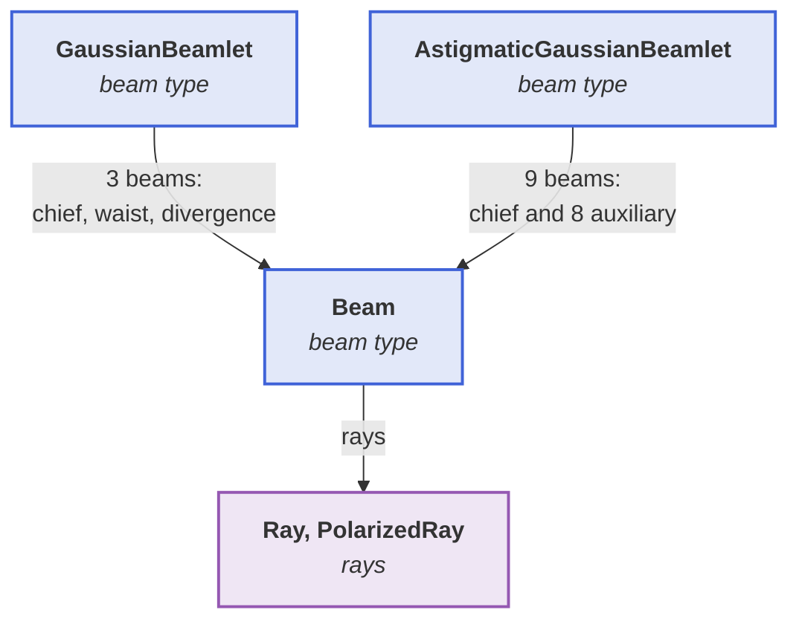

```@setup beam_catalog
beam_catalog_dir = joinpath(@__DIR__, "..", "..", "assets", "beam_renders")

Main.DocUtils.conditional_include(joinpath(beam_catalog_dir, "beam_catalog_showcase.jl"))
```

# Beams

As mentioned in the [Rays](@ref) section, a beam within the context of this package serves as a data structure for storing collections of rays, forming the backbone of the simulation framework. A beam splits into child beams, e.g. at a beamsplitter, and [`solve_system!`](@ref) traces it together with all its children. Browse the catalog below, or refer to the table of contents for detailed documentation of the provided beam types and sources.

## Beam catalog

Beams, beamlets and beam groups are traced through a bi-convex lens onto a detector near its focus.

```@raw html
<ComponentCatalog catalog="beams" />
```

## Beam overview

```@contents
Pages = ["beams.md", "stigmatic_beam.md", "astigmatic_beam.md", "beam_groups.md"]
Depth = 2
```

## Beam models

The beamlets are traced as several [`Beam`](@ref)s of rays side by side (blue: beam types, purple: rays):



A beamlet stops when its rays hit different shapes or its invariant check fails. The tracing loop and the interface of a beam type are described in [Tracing a beamlet](@ref) and [Beam interface](@ref).

## Moving beams

Rays, beams and beam groups can be moved with the same kinematic API as optical elements, see [Moving sources](@ref) in the [Kinematics](@ref) section.
