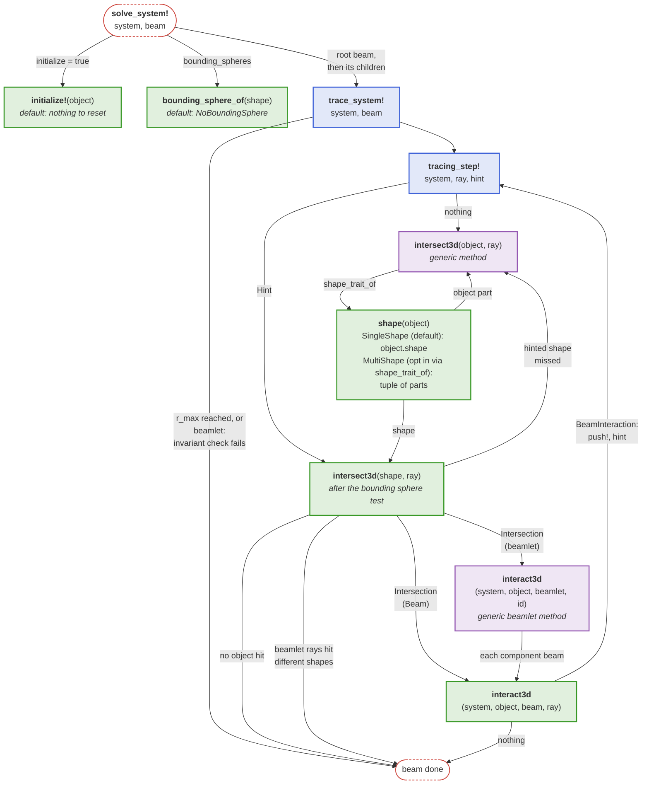
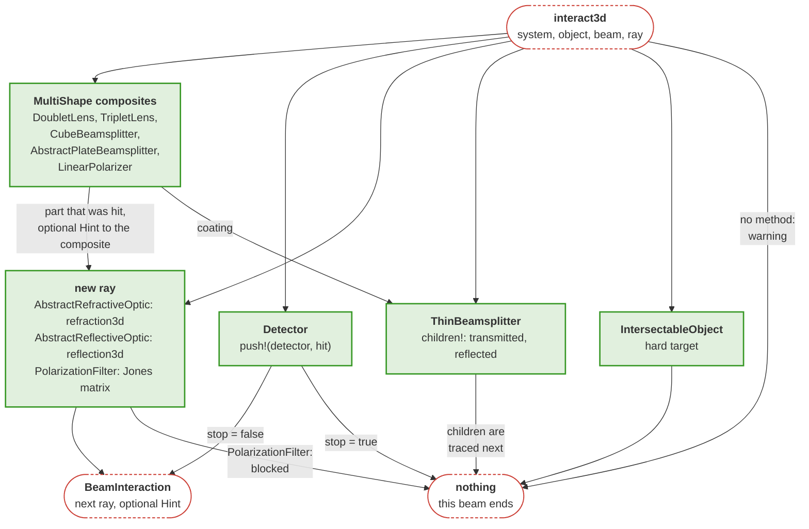

```@setup components
catalog_showcase_dir = joinpath(@__DIR__, "..", "..", "assets", "catalog_assets")

Main.DocUtils.conditional_include(joinpath(catalog_showcase_dir, "catalog_showcase.jl"))
```

# Optical components

Optical elements serve as the building blocks for optical systems in the context of this package, representing components such as mirrors, lenses, filters and so on. A collection of basic optical elements is provided with this package as is. They are tested for the correctness of their optical interactions and are verified to work with reasonable fidelity. Browse the catalog below, or refer to the [Mirrors](@ref), [Lenses](@ref), [Prisms](@ref), [Beamsplitters](@ref), [Detectors](@ref) and [Polarizers](@ref) pages for detailed documentation.

## Component overview

```@raw html
<ComponentCatalog />
```

## Moving components

Optical elements can be moved freely in 3D space and combined into groups that move as one, see [Moving optical elements](@ref) in the [Kinematics](@ref) section.

## Inspecting components

[`BeamletOptics.properties`](@ref) lists what a component stores as `name => value` pairs, e.g. its type, pose, shape and optical parameters. Values are SI numbers; the unit is given in brackets at the end of the name, names without brackets are dimensionless. It also works for shapes, beams and sources. Tools such as the inspector of the [BeamletOpticsGUI](https://github.com/StackEnjoyer/BeamletOpticsGUI.jl) live view display this list.

```julia
lens = SphericalLens(50e-3, -50e-3, 5e-3, 25.4e-3)
BeamletOptics.properties(lens)            # e.g. "Type" => "Lens", "Position [m]" => [0.0, 0.0, 0.0], ...
```

A new `AbstractObject` subtype gets the [`BeamletOptics.default_properties`](@ref) (type, pose and shape) without further work; a method of `properties` for the subtype adds its own parameters.

```@docs; canonical=false
BeamletOptics.properties
BeamletOptics.default_properties
```

## Listing available components

When using this package in the REPL, a tree view of all implemented [`BeamletOptics.AbstractObject`](@ref)s can be generated via the [`BeamletOptics.list_subtypes`](@ref) helper function. Note that this function is not able to determine all available constructors.

```@repl
using BeamletOptics # hide
BeamletOptics.list_subtypes(BeamletOptics.AbstractObject);
```

## Where the physics lives

The geometry of a component lives in its shape, its optical effect in its [`BeamletOptics.interact3d`](@ref) method; the solver connects both in the [Intersect-Interact-Repeat-Loop](@ref).

The following diagram shows which functions a solve calls on an object: a new `AbstractObject` subtype implements the green ones, `interact3d` always and the others only where the defaults or the existing shapes do not fit, and may override the generic methods in purple:



The `interact3d` methods of the component families decide what follows a hit: a new ray, child beams, a recorded hit, a hand-over to the part of a composite that was hit, or the end of the beam:

