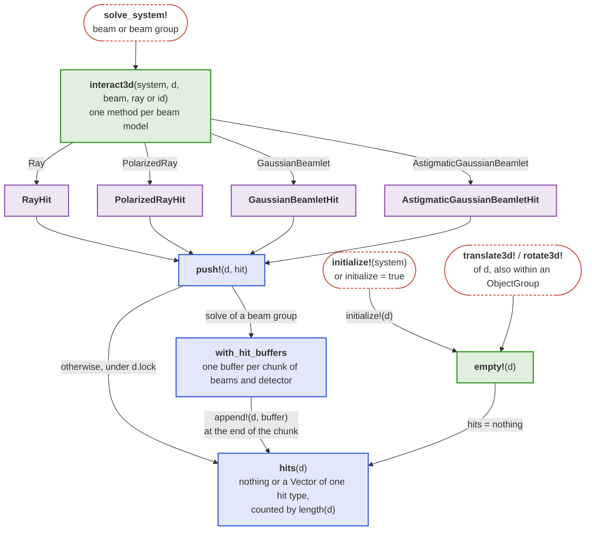
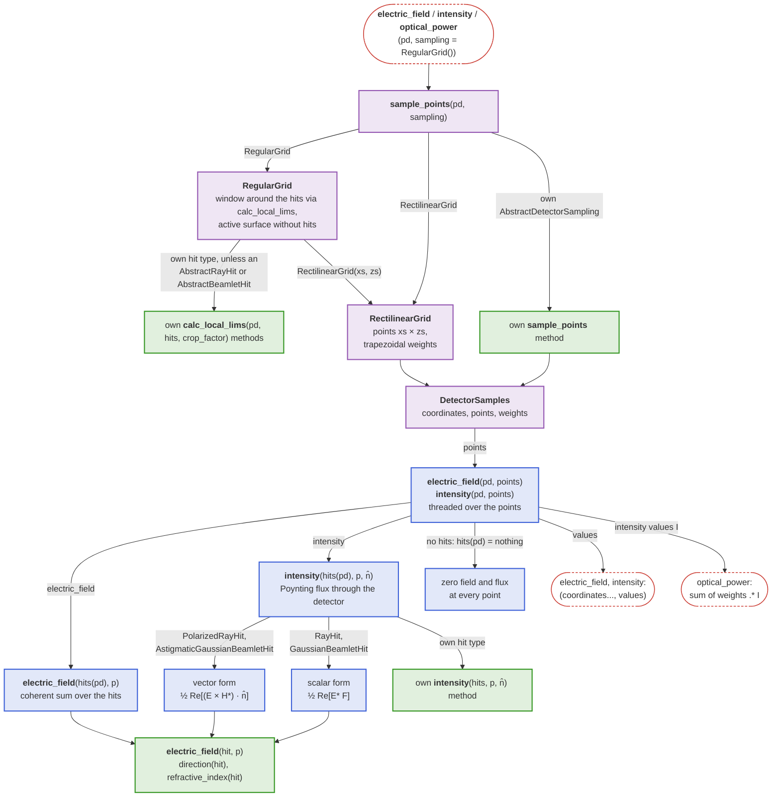
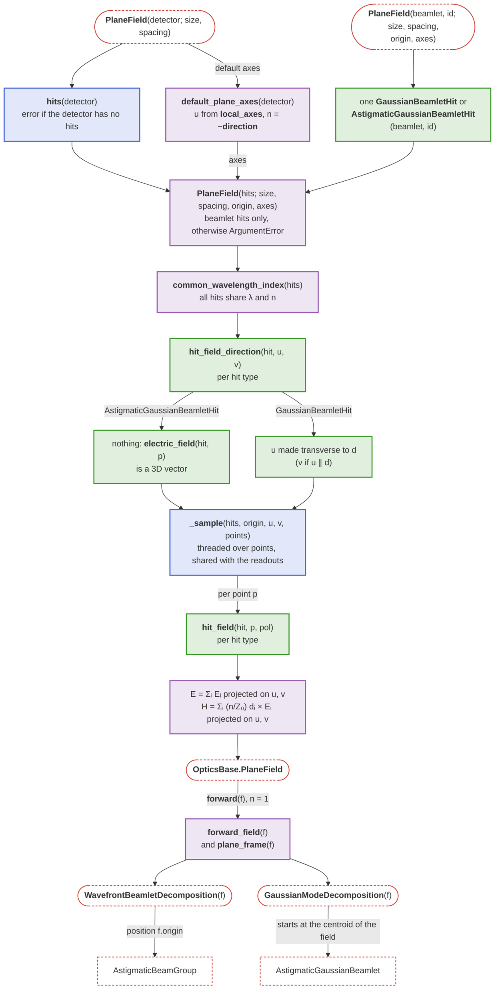

```@setup detectors
detector_showcase_dir = joinpath(@__DIR__, "..", "..", "assets", "detector_assets")

Main.DocUtils.conditional_include(joinpath(detector_showcase_dir, "spotdetector_showcase.jl"))
Main.DocUtils.conditional_include(joinpath(detector_showcase_dir, "photodetector_showcase.jl"))
```

# Detectors

In practice, photodetectors allow the conversion of electromagnetic radiation into electric signals. BMO provides the [`Detector`](@ref) as an element to capture and evaluate optical data during and after running a simulation, respectively. The `Detector` is designed to accumulate e.g. field or ray data, enabling analysis of intensity distributions, interference patterns, and other beam properties. Currently, post-processing capabilities are limited to the functionality as described in the [Spot diagrams](@ref) and [Field distributions](@ref) sections.

In general, detector-like elements are supposed to fall under the [`BeamletOptics.AbstractDetector`](@ref) type, which defines a interface for detector implementations.

!!! warning "Resetting detectors"
    By default, the data stored in a `Detector` is not reset between calls of [`solve_system!`](@ref). This is intentional, since all beams of a beam group and several sources solved one after another are meant to superpose on the same detectors. To start from empty detectors, e.g. when a component is changed in a loop, solve with `initialize = true` or call [`initialize!`](@ref)`(system)`, which resets all detectors of a [`System`](@ref) including those in nested [`ObjectGroup`](@ref)s. A single detector is reset with [`empty!`](@ref). Hits are pushed under a lock, so beam groups can safely be solved multithreaded.

## Detector type

A `Detector` can be easily spawned by initializing e.g. `pd = Detector(5mm)` which will create a 5x5 mm² detection screen.

```@docs; canonical=false
Detector(::Real, ::Bool)
Detector
```

After solving a system containing a `Detector`, the methods listed below can be used in order to analyze the stored data. If no data is obtained during the tracing procedure, an error message will be stored.

## Reading out a detector

A detector stores *hits*. The following rules define what a readout computes.

1. A hit holds the values of the ray or beamlet at the moment of the solve. Solving again, or moving a source or any other component, does not change hits that are already stored.
2. Any kinematic call on the detector (e.g. [`translate3d!`](@ref) or [`rotate3d!`](@ref)) empties it, also when it is moved as part of an [`ObjectGroup`](@ref), since its hits would no longer lie on its surface.
3. A detector can hold the hits of solves that follow each other in time side by side. It is up to the user when to evaluate them. [`spot_diagram`](@ref) shows all hits, which is harmless. [`electric_field`](@ref), [`intensity`](@ref) and [`optical_power`](@ref) superpose all hits **coherently**. This is right for beams that exist at the same time, e.g. a beam group or an interferometer. For solves that follow each other in time, the user must know what this computes, or evaluate after each solve and reset the detector (`initialize = true`, [`initialize!`](@ref) or [`empty!`](@ref)).

```julia
# Reset and evaluate after every solve
for y in ys
    translate_to3d!(mirror, [0, y, 0])
    solve_system!(system, source; initialize = true)
    push!(powers, optical_power(pd))
end

# Solve several times, evaluate once: the spots of all solves
for _ in 1:10
    zrotate3d!(source, deg2rad(1))
    solve_system!(system, source)
end
spots = spot_diagram(pd)
```

The following diagram shows how a solve records one hit type per beam model in a `Detector` and what empties it again; green boxes are the methods a new [`BeamletOptics.AbstractDetector`](@ref) implements.



## Spot diagrams

The `spot_diagram` method provides a straight forward way to generate spot diagrams, which are commonly used to perform initial assessments of the optical performance of an imaging setup.

```@docs; canonical=false
spot_diagram
```

The following image shows the spot diagram of a Sonnar lens. Two [`CollimatedSource`](@ref)s are traced through the system at different angles. A [`Detector`](@ref) is positioned at the focal plane to capture the resulting spot diagrams, which are visualized using the method explained above.


## Ray directions

Where a ray crossed the detector is half of what it carries; [`ray_hits`](@ref) also returns the direction in which it went, both in the coordinates of the detector. The angle of each ray to the detector normal over its distance from the detector center shows, for example, how far a beam is from collimated:

```julia
using LinearAlgebra: norm
pts, dirs = ray_hits(pd)
r = norm.(pts)                                   # distance from the detector center [m]
θ = [atan(hypot(d[1], d[3]), abs(d[2])) for d in dirs] # angle to the normal [rad], either side
```

```@docs; canonical=false
ray_hits
```

## Field distributions

Alternatively, the detector data can also be used to reconstruct electric field distributions of incoming beams on its surface using coherent addition. Three readouts build on each other: [`electric_field`](@ref) is the coherent sum of the fields of all hits, [`intensity`](@ref) the flux of the Poynting vector of that field through the detector, and [`optical_power`](@ref) the integral of the intensity. Their definitions follow.

```@docs; canonical=false
electric_field(::Detector, ::BeamletOptics.AbstractDetectorSampling)
electric_field(::BeamletOptics.AbstractDetectorHit, ::AbstractVector)
intensity(::Detector, ::BeamletOptics.AbstractDetectorSampling)
optical_power(::Detector, ::BeamletOptics.AbstractDetectorSampling)
```

### Sampling

Where on the detector the readouts are evaluated is set by a sampling, the second argument of each readout. It chooses its window, the points in local detector coordinates and the weights with which [`optical_power`](@ref) integrates the intensity. The default is a [`RegularGrid`](@ref) around the hits; a [`RectilinearGrid`](@ref) is a grid of one's own with any spacing.

```julia
x, z, I = intensity(pd, RegularGrid(num_points = 200, crop_factor = 5))
P = optical_power(pd, RectilinearGrid(xs, zs))
```

The following diagram shows how a readout turns a sampling into points and evaluates the stored hits there; green boxes are the methods a new sampling or hit type implements. A new hit type must also be added to the `hits` field of [`Detector`](@ref).



```@docs; canonical=false
RegularGrid
RectilinearGrid
BeamletOptics.AbstractDetectorSampling
BeamletOptics.sample_points
BeamletOptics.DetectorSamples
electric_field(::Detector, ::AbstractArray{<:AbstractVector})
intensity(::Detector, ::AbstractArray{<:AbstractVector})
```

### Gaussian beamlet interference

One of the use cases of the [`Detector`](@ref) is to analyse interference patterns. Below a rendered example of a detector model ([FDS010](https://www.thorlabs.com/thorproduct.cfm?partnumber=FDS010)) can be seen. The detector active area is marked in blue (1x1 mm²). 


The figure below demonstrates an example intensity distribution captured by the detector pictured above, showing radial fringes due to a mismatch of the radii of curvature of the interfering [`GaussianBeamlet`](@ref)s. In addition, the beam waists have been visualized.

!!! tip "Interferometer tutorial"
    Refer to the [Michelson interferometer](@ref) section for a detailed tutorial on how to use the [`Detector`](@ref).


### Point spread function estimation

If a [`Detector`](@ref) is placed in the focal plane of an imaging system, the coherent addition of the ray-attached plane waves yields an estimate of its point spread function (PSF). For the Sonnar example from the [Spot diagrams](@ref) section the following distribution was calculated for the on-axis beam bundle. 

!!! warning "Experimental feature"
    The PSF estimation does not use pupils (yet) but merely superimposes the ray-attached plane waves. It gives qualitatively sound results, but requires good sampling of the problem to be quantitatively meaningful. No Strehl ratio is calculated.


For [`PolarizedRay`](@ref)s the field is added as 3D vectors, so [`electric_field`](@ref) returns a matrix of complex vectors and each component of the focal field can be analyzed separately. This becomes relevant at high NA, where the field vectors tilt towards the optical axis. The same holds for [`AstigmaticGaussianBeamlet`](@ref)s.

!!! tip "PSF examples"
    The [Point spread functions](@ref) example page covers the Airy disc, an aberrated asphere and the vectorial focus of a parabolic mirror at NA 0.88, including the caveats on collimated sources and ray amplitudes.

### OpticsBase interoperability

If [OpticsBase.jl](https://github.com/StackEnjoyer/OpticsBase.jl) is loaded alongside BMO (`using OpticsBase`), the `BeamletOpticsOpticsBaseExt` package extension adds a `PlaneField` constructor for a `Detector`. It samples the physical field of the beamlet hits as tangential electric *and* magnetic field on the detector plane, OpticsBase's single exchange format for coupling to other Maxwell solvers (angular spectrum propagators, BPM, FDTD, ...). As for [`intensity`](@ref)`(::Detector)`, the Poynting flux of an oblique beam through the plane is the full beam power.

The field is built from the hits as follows:

- `E` is the coherent sum of the 3D fields ``\mathbf{E}_i`` of the hits at the sample points, projected onto the plane axes ``\mathbf{u}`` and ``\mathbf{v}``.
- `H` is the coherent sum, **over hits**, of ``(n_\mathrm{medium}/Z_0)\, \mathbf{d}_i \times \mathbf{E}_i``. Here ``\mathbf{d}_i`` is the propagation direction of the chief or stigmatic ray of hit ``i`` and ``\mathbf{E}_i`` is that hit's own 3D field contribution at the sample point. It is not the paraxial ``(n/Z_0)\, \mathbf{n} \times \mathbf{E}`` built from the *total* field, which would be exact only for normal incidence. This matches the surface-equivalence-theorem content of `PlaneField` even for beams that hit the plane off-normal.
- The default `axes` follow the detector: ``\mathbf{n}`` is `-direction(detector)` (BMO's detector normal points against the beam, so ``\mathbf{n}`` points downstream, the direction the light was travelling in when it hit the detector), ``\mathbf{u}`` is the local detector x axis of BMO and ``\mathbf{v} = \mathbf{n} \times \mathbf{u}`` is BMO's local ``-z`` axis. This is the default port of BMO's detector readouts.
- [`AstigmaticGaussianBeamletHit`](@ref BeamletOptics.AstigmaticGaussianBeamletHit)s carry the polarization of their chief ray, so their field is `electric_field(hit, p)` already. A stigmatic [`GaussianBeamletHit`](@ref BeamletOptics.GaussianBeamletHit) carries no polarization in BMO (the model is scalar). By convention, matching OpticsBase's own rule for a scalar field (`PlaneField(E::AbstractMatrix, ...)` puts a scalar field entirely into `Eu`), its contribution is polarized along the plane's ``\mathbf{u}`` axis, made transverse to the hit direction ``\mathbf{d}_i`` (along ``\mathbf{v}`` if ``\mathbf{u}`` is parallel to it), so that ``\mathbf{E}_i \perp \mathbf{d}_i`` and ``\mathbf{H}_i = (n/Z_0)\, \mathbf{d}_i \times \mathbf{E}_i`` form a consistent plane wave. At normal incidence this is exactly ``\mathbf{u}``.
- `R = Inf`: no reference sphere is removed, because BMO's beamlet field already carries the full spatial phase without needing one.

The diagram shows how the constructors share one sampling of the hits and how the return path leaves the `PlaneField` again. Blue boxes are BMO's detector internals that the extension reuses, green boxes depend on the hit type, purple boxes are the rest of the extension.



```@docs
OpticsBase.PlaneField(::Detector)
```

The return paths, [`WavefrontBeamletDecomposition`](@ref) and [`GaussianModeDecomposition`](@ref) for a `PlaneField`, are documented in [OpticsBase fields as beam groups](@ref). Without a detector, a single traced beamlet segment is sampled with `PlaneField(beamlet, id; ...)`, which components that hand light to another solver use in their `interact3d` method, see [Re-emitting components](@ref).
