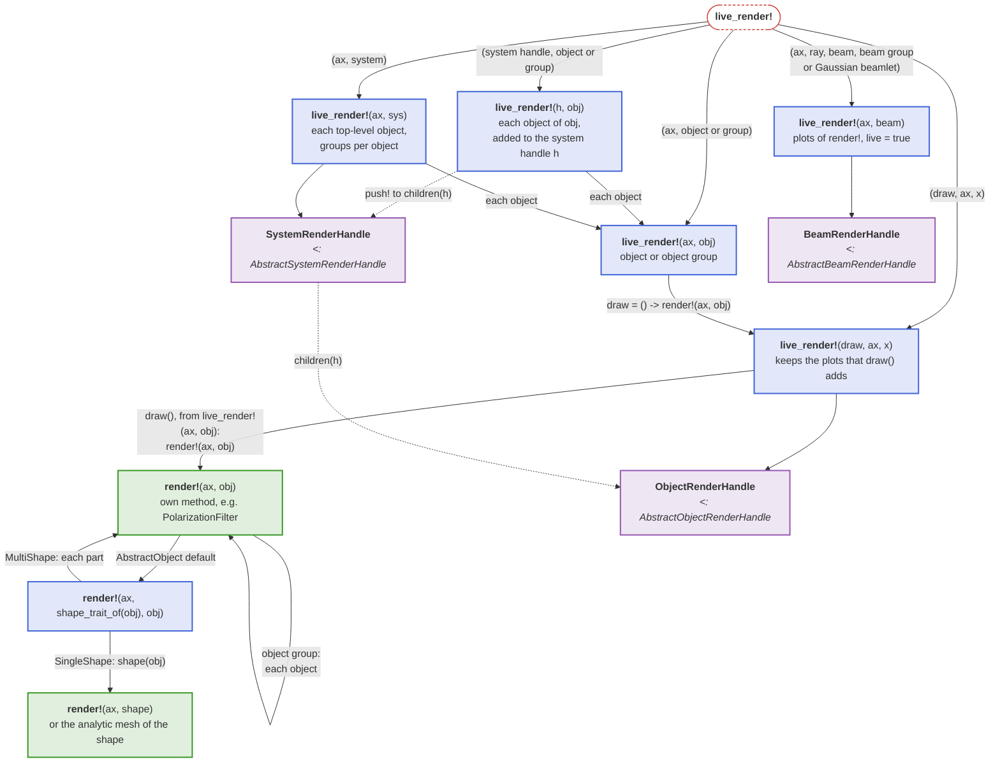
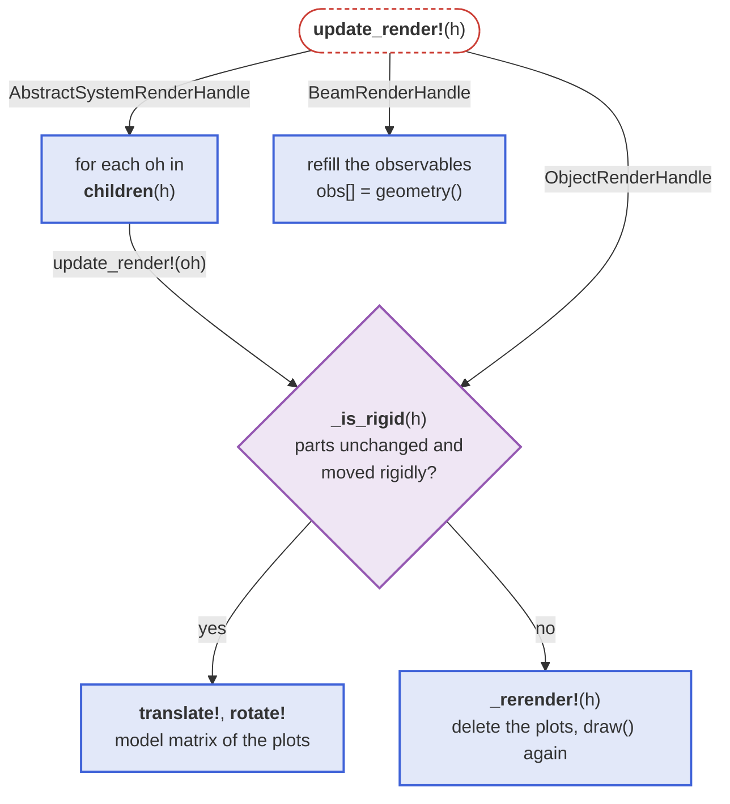
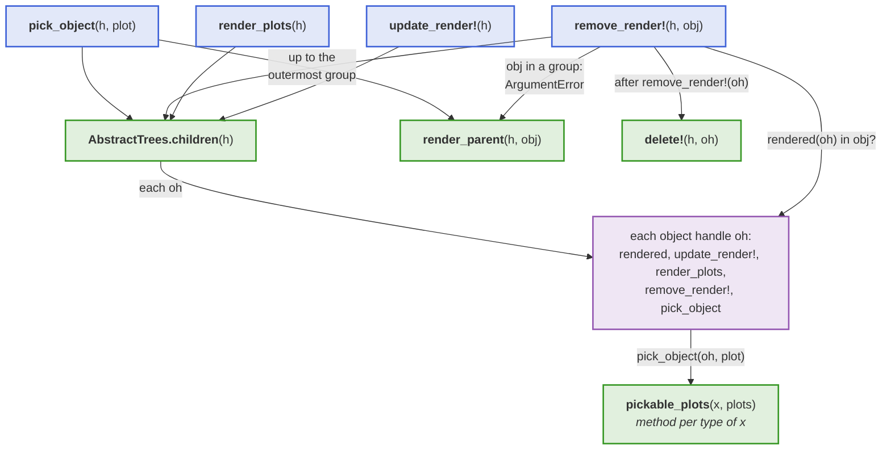

# Live rendering

`render!` generates new plots on every call. For animations and interactive applications, where
components are moved and the system is re-solved many times per second, use
[`live_render!`](@ref) instead. It returns a handle that re-synchronizes the existing plots with
the current simulation state via [`update_render!`](@ref):

```julia
using GLMakie, BeamletOptics

fig = Figure()
ax = LScene(fig[1, 1])

hsys = live_render!(ax, system)   # geometry is generated once
hbeam = live_render!(ax, beam)    # all ray segments bundled into a single plot

zrotate3d!(mirror, 1e-3)
solve_system!(system, beam)
update_render!(hsys)              # moved components: only their model transformation changes
update_render!(hbeam)             # beam path: point buffer is replaced in place
```

The diagram shows which `live_render!` method draws a thing and which handle it returns; the green boxes are the `render!` methods a component or shape adds to be drawn:



- **Objects and systems**: the geometry is rendered once with `render!`. Kinematic changes
  (`translate3d!`, `rotate3d!`, ...) are then applied as a rigid model transformation of the
  existing plots, which costs microseconds regardless of the mesh resolution.
- **Rays, beams and beam groups**: all segments are drawn by a single `linesegments` plot, so the
  number of plots does not grow with the number of rays. The number of segments may change
  between updates, e.g. when a component is moved out of the beam path.
- **Gaussian beamlets**: the 1/e² envelope of all segments is merged into a single mesh. This
  applies to `GaussianBeamlet`s, `AstigmaticGaussianBeamlet`s and groups of astigmatic beamlets,
  of which every `render_every`-th beamlet is rendered.

The diagram shows what `update_render!` does for each handle type:



`live_render!` draws the same plots as `render!`, see [Rays and beams](@ref "Rendering rays and beams") and [Gaussian beamlets](@ref "Rendering Gaussian beamlets"); it only keeps the data they are drawn from. Use [`remove_render!`](@ref) to delete the plots of a handle.

## Render handle protocol

Every handle returned by `live_render!` is a [`BeamletOptics.AbstractRenderHandle`](@ref). Packages
built on BeamletOptics, e.g. [BeamletOpticsGUI](https://github.com/StackEnjoyer/BeamletOpticsGUI.jl),
use the handles through a protocol instead of the concrete handle types of the Makie extension. There
are three abstract handle types: [`BeamletOptics.AbstractObjectRenderHandle`](@ref) for a component,
[`BeamletOptics.AbstractSystemRenderHandle`](@ref) for a system and
[`BeamletOptics.AbstractBeamRenderHandle`](@ref) for a ray, beam or beam group. They share the
accessors below.

```@docs; canonical=false
BeamletOptics.rendered
BeamletOptics.render_plots
```

A system handle groups the handles of its objects. It can be searched and changed at runtime:

```@docs; canonical=false
BeamletOptics.children(::BeamletOptics.AbstractSystemRenderHandle)
BeamletOptics.render_parent
Base.push!(::BeamletOptics.AbstractSystemRenderHandle, ::BeamletOptics.AbstractObjectRenderHandle)
Base.delete!(::BeamletOptics.AbstractSystemRenderHandle, ::BeamletOptics.AbstractObjectRenderHandle)
```

`push!` adds an object handle at the top level, `delete!` removes it from the system handle without
deleting its plots (use [`remove_render!`](@ref) for that). [`update_render!`](@ref),
[`remove_render!`](@ref) and [`pick_object`](@ref) work on any system handle through these accessors,
so a handle type of your own only needs to implement them.

The diagram shows which accessors and hooks (green) the methods of a system handle (blue) call, and where they pass on to the object handles (purple):



An object that is added to a system at runtime, see [Changing a system](@ref), is rendered into the
handle of the system, and removed from it again, by:

```@docs; canonical=false
BeamletOptics.live_render!(::BeamletOptics.AbstractSystemRenderHandle, ::BeamletOptics.ObjectOrGroup)
BeamletOptics.remove_render!(::BeamletOptics.AbstractSystemRenderHandle, ::BeamletOptics.ObjectOrGroup)
```

```julia
push!(system, lens)
live_render!(hsys, lens)     # draws the lens, hsys now updates and picks it
delete!(system, lens)
remove_render!(hsys, lens)   # deletes its plots and its handle
```

Beam handles report how they were drawn, and can change it at runtime, e.g. the drawn length of the
final rays or the color (a single color or the color of the wavelength of each ray), without
creating new plots:

```@docs; canonical=false
BeamletOptics.render_settings
BeamletOptics.render_settings!
```

Overlays that are not part of a component, e.g. markers, are drawn with the function form of
`live_render!`, which returns a handle for the plots `draw` creates and moves them together with `x`:

```@docs; canonical=false
BeamletOptics.live_render!(::Function, ::Any, ::Any)
```

[`pick_object`](@ref) finds the object that owns a picked plot. By default all plots of an object
select it; a method of `pickable_plots` restricts this, e.g. to exclude an outline. The colors of the
material classes of the active look are available via `look_colors`:

```@docs; canonical=false
BeamletOptics.pickable_plots
BeamletOptics.look_colors
```
